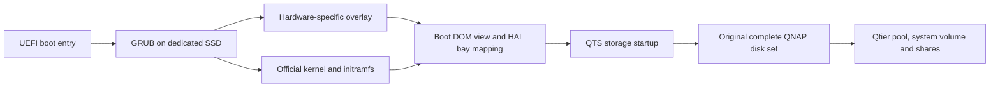
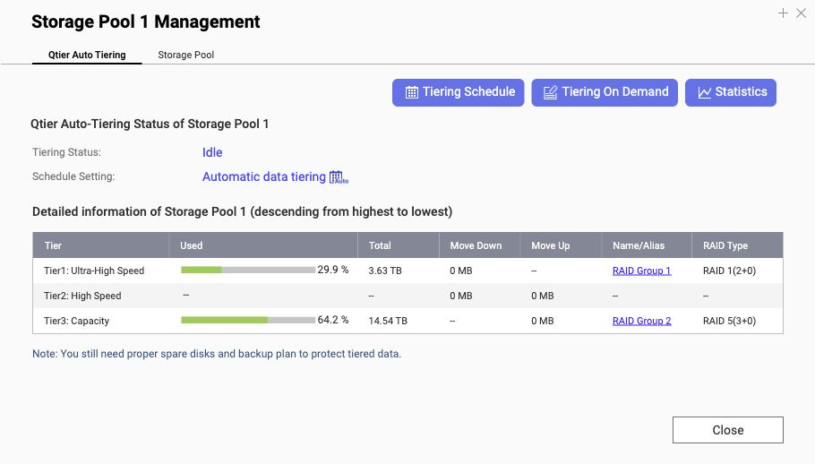

# QTS on generic x86: installation and data recovery

An evidence-based field guide to booting QTS on non-QNAP x86 hardware and recovering an existing QNAP disk set, including a real Qtier migration.

[中文入口](README.zh-CN.md) · [Screenshot journal](docs/screenshots.md) · [Verified case](docs/case-study.md) · [Troubleshooting](docs/09-troubleshooting.md)

**This is a recovery engineering guide, not a universal installer or an officially supported QNAP migration destination.** Start with copies of your disks when possible. A normal QTS boot can write to attached disks before you click anything. If the data is irreplaceable and members are failing, stop experiments on the originals and arrange recovery imaging.

## The build: a Ryzen-powered QTS NAS

**8 cores / 16 threads · 64 GiB ECC memory · 8 SATA bays · recovered SSD + HDD Qtier**

The payoff: the familiar QTS desktop running on a Ryzen 7 5800X, with the original tiered storage back online. This is a custom x86 build using a TS-877 profile, not a factory QNAP appliance or a benchmark claim.

| Component | This build |
|---|---|
| CPU | AMD Ryzen 7 5800X, 8 cores / 16 threads |
| Motherboard | ASRock Rack X570D4U-2L2T |
| Memory | 2 × 32 GiB ECC UDIMM, 3200 MT/s; four slots correctly reported |
| Bays | Eight mapped SATA positions, with an eight-large-bay front preview |
| Recovered Qtier | 2 × 4 TB SSD RAID1 + 3 × 8 TB HDD RAID5; QTS reports an 18.17 TB pool |
| Dedicated boot | Samsung 980 500 GB NVMe |
| Monitoring | CPU temperature and all eight SATA disk temperatures visible in QTS |

*Motherboard temperature remains Not Supported; the DIMM manufacturer label remains Unknown. Hardware-display and cache-candidate fixes are live-verified and saved in the boot overlay, but their post-change reboot test is still pending. See [hardware and app follow-up](docs/07a-hardware-and-apps.md).*

## What worked

A dedicated NVMe SSD booted through UEFI → GRUB → the QTS kernel and initramfs, with a small hardware adaptation overlay. Five original QNAP disks then recovered their old configuration and Qtier pool: two SSDs in RAID1 plus three HDDs in RAID5. All eight configured bays passed HAL identity/slot checks. A reboot with virtual CD detached reached QTS automatically; the pool, both data volumes and sample files were readable.

**The boot SSD holds bootloader and firmware. The QTS system volume lives on the separate data pool.** Using the unused tail of the boot SSD as a QTS data volume was not validated. Unattended automatic updates were not validated either.

## Start here: executable walkthrough

After reading scope and backup requirements, follow the [Linux command walkthrough](docs/10-command-walkthrough.md). It supplies dependency installation, firmware extraction, image construction/readback, a disposable QEMU launch, payload ISO creation, explicit-target boot SSD writing, and post-migration checks. The commands distinguish VM and physical profiles; original data disks are never installation targets.

## Read in this order

| Stage | Guide | Exit condition |
|---|---|---|
| 0 | [Scope and decisions](docs/00-scope.md) | Correct OS/storage family identified |
| 1 | [Inventory and backup](docs/01-inventory.md) | Every member identified; recovery copy/backup strategy recorded |
| 2 | [Firmware and loader](docs/02-firmware.md) | Provenance, exact versions and boot dependencies recorded |
| 3 | [VM validation](docs/03-vm-validation.md) | Initialize disposable disks, update and cold-boot successfully |
| 4 | [Build and install](docs/04-build-and-install.md) | Verified image on the intended dedicated boot SSD |
| 5 | [Map every bay](docs/05-bay-mapping.md) | Scan **and** per-disk HAL reverse lookup pass |
| 6 | [Recover the disk set](docs/06-migration.md) | Correct pool, tiers, RAID groups and volumes recovered |
| 7 | [Independent boot and acceptance](docs/07-acceptance.md) | No CD/BootNext dependency; data checks recorded |
| 7a | [Hardware display and apps](docs/07a-hardware-and-apps.md) | CPU/DIMMs, artwork, cache eligibility and app inventory checked independently |
| 8 | [Updates and rollback](docs/08-updates.md) | Each proposed version tested before production use |

## Repository contents

- Detailed procedures and failure analysis, with hardware-specific observations clearly labeled.
- Screenshots of installation, troubleshooting, recovered storage and hardware status.
- Configuration templates and a deterministic overlay packer. These do not discover a correct profile for you.
- A read-only Linux inventory collector and a file manifest tool. Reports contain private identifiers: keep them local.
- No QNAP firmware, third-party loader binaries, credentials, disk images or customer data.

Run the offline tool tests with Python 3.9+: `python3 -m unittest discover -s tests -v`.

## Recovered Qtier pool

Current English-UI capture after the hardware follow-up: SSD RAID1 and HDD RAID5 tiers remain present. The [earlier unattended-reboot evidence](docs/screenshots.md#qtier-after-default-reboot) is retained separately; this new capture is not a new reboot test.

## What this does not promise

One successful host is not a hardware compatibility list. Driver availability, HAL behavior, firmware family, encryption and pool history all matter. QTS, QuTS hero and QuTScloud are different targets. This guide does not bypass firmware signatures, licenses or activation, and does not supply a complete clean-room replacement for the community loader used in the case.

For supported appliance-to-appliance migration, check [QNAP's migration compatibility tool](https://www.qnap.com/en/nas-migration). For uncertain or damaged pools, prefer recovering files to another device over making the pool boot in place.

See the [first-reader audit](docs/first-reader-audit.md) for what the command walkthrough was checked against and what still requires hardware validation.

Contributions with reproducible, sanitized results are welcome. See [CONTRIBUTING.md](CONTRIBUTING.md) and [sources](docs/sources.md).
