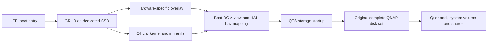

# QTS on generic x86: installation and data recovery

A practical guide to booting QTS on non-QNAP x86 hardware and recovering an existing QNAP disk set, including a real Qtier migration.

[中文入口](README.zh-CN.md) · [Preview gallery](docs/screenshots.md) · [Verified case](docs/case-study.md) · [Troubleshooting](docs/09-troubleshooting.md)

**This is a recovery engineering guide, not a universal installer or an officially supported QNAP migration destination.** Start with copies of your disks when possible. A normal QTS boot can write to attached disks before you click anything. If the data is irreplaceable and members are failing, stop experiments on the originals and arrange recovery imaging.

## Choose your release

| Route | Current selection (checked 2026-10-22) | Start here |
|---|---|---|
| **QTS 5.2 stable** | 5.2.11.3652 / 20261014, TS-X77 reference; previous 5.2.10 baseline tested | [Release choice and downloads](docs/02a-release-tracks.md) |
| **QTS 6.1 Public Beta** | 6.1.0.3640 / 20261007, TS-X73A reference; VM upgrade and physical Qtier recovery tested | [Release choice and differences](docs/02a-release-tracks.md) |

Both routes use **one [step-by-step command walkthrough](docs/10-command-walkthrough.md)**. Choose firmware/profile variables once; extraction, image construction, VM testing, installation, bay mapping and storage recovery are shared. Newer releases must pass the same gates—“latest available” does not mean “tested here.” Already running custom QTS 5.2? Use the [existing-installation upgrade branch](docs/11-qts61-upgrade.md#3-upgrade-an-existing-custom-qts-installation).

## Reference hardware

**8 cores / 16 threads · 64 GiB ECC memory · 8 SATA bays · recovered SSD + HDD Qtier**

The reference build runs the QTS desktop on a Ryzen 7 5800X with the original tiered storage available. The original installation used TS-877/X77; the later 6.1 upgrade uses TS-873A/X73A on the same hardware. This is a custom build, not a factory QNAP appliance or a benchmark claim.

| Component | This build |
|---|---|
| CPU | AMD Ryzen 7 5800X, 8 cores / 16 threads |
| Motherboard | ASRock Rack X570D4U-2L2T |
| Memory | 2 × 32 GiB ECC UDIMM, 3200 MT/s; four slots correctly reported |
| Bays | Eight mapped SATA positions, with an eight-large-bay front preview |
| Recovered Qtier | 2 × 4 TB SSD RAID1 + 3 × 8 TB HDD RAID5; QTS reports an 18.17 TB pool |
| Dedicated boot | Samsung 980 500 GB NVMe |
| Monitoring | CPU, motherboard temperature and two fan readings; validate sensor mapping for your board |

*QTS 5.2 hardware view. The System temperature field predates the board-sensor adaptation; see [monitoring setup](docs/07a-hardware-and-apps.md#cpu-motherboard-and-fan-readings) for current guidance.*

## Expected result

A dedicated NVMe SSD booted through UEFI → GRUB → the QTS kernel and initramfs, with a small hardware adaptation overlay. Five original QNAP disks then recovered their old configuration and Qtier pool: two SSDs in RAID1 plus three HDDs in RAID5. All eight configured bays passed HAL identity/slot checks. A reboot with virtual CD detached reached QTS automatically; the pool, both data volumes and sample files were readable.

**The boot SSD holds bootloader and firmware. The QTS system volume lives on the separate data pool.** Using the unused tail of the boot SSD as a QTS data volume was not validated. Unattended automatic updates were not validated either.

## Read in this order

Choose the route for your current task. Chapter numbers identify documents; optional chapters are not additional recovery requirements.

| Your task | Start here | Continue with |
|---|---|---|
| Recover an existing QNAP disk set on a new x86 host | [Recovery route below](#recover-a-disk-set-on-a-new-host) | Complete the storage and independent-boot gates before optional changes |
| Upgrade an already working custom QTS installation | [Updates and rollback](docs/08-updates.md#per-release-sequence) | For X77 → X73A / 6.1, use [the existing-installation branch](docs/11-qts61-upgrade.md#3-upgrade-an-existing-custom-qts-installation), not the clean-install recipe |
| Fix hardware reporting, apps or enclosure previews | [Optional configuration](#optional-configuration-after-recovery) | Choose only the relevant guide after storage acceptance and data export |

### Recover a disk set on a new host

Use the [command walkthrough](docs/10-command-walkthrough.md#how-to-use-this-walkthrough) alongside these decision guides. It supplies commands at each stage, not an extra stage to repeat afterward.

| Order | Read and act | Gate before continuing |
|---|---|---|
| 1 | [Scope](docs/00-scope.md) → [inventory and backup](docs/01-inventory.md) | Correct storage family, complete disk identities and recovery copies |
| 2 | [Choose a release](docs/02a-release-tracks.md) → [firmware and loader requirements](docs/02-firmware.md) | Exact package/profile and reviewed build inputs |
| 3 | [Build and validate the disposable VM](docs/03-vm-validation.md#build-and-start-the-lab-in-order), using [walkthrough sections 1–6](docs/10-command-walkthrough.md#1-build-machine-and-directory-layout) | Initialization, test-file reads, update and disk-only cold start pass |
| 4 | [Collect physical topology](docs/05-bay-mapping.md#concrete-linux-topology-collection), then [build/install a separate physical candidate](docs/04-build-and-install.md#b-build-a-separate-physical-candidate) | Correct dedicated boot SSD written and read back; diagnostic boot available |
| 5 | [Validate every bay](docs/05-bay-mapping.md#turn-the-inventory-into-a-tested-profile) | Physical identities, HAL scan and each reverse lookup agree; no normal storage startup yet |
| 6 | [Recover the complete disk set](docs/06-migration.md#decide-before-clicking-anything) | Correct pool, RAID members, Qtier tiers, volumes and file reads |
| 7 | [Independent boot and acceptance](docs/07-acceptance.md) | Data export, permanent boot defaults and post-boot storage checks recorded in the [acceptance checklist](templates/acceptance.md) |

The physical topology feeds the candidate profile **before** installation; the full HAL mapping check runs in diagnostics **after** installation. If it fails, correct the candidate and repeat diagnostics before proceeding to recovery.

### Optional configuration after recovery

| Task | Relevant guide |
|---|---|
| CPU, motherboard/fan readings or memory reporting | [Hardware checks](docs/07a-hardware-and-apps.md#before-you-start) |
| Missing cross-architecture applications | [Preserve and inventory app data](docs/07a-hardware-and-apps.md#arm64-apps-preserve-data-inventory-before-cleanup) |
| Missing SSD-cache candidates | [Check slot eligibility](docs/07a-hardware-and-apps.md#ssd-cache-candidates-a-slot-capability-bitmap); this does not authorize creating a cache |
| Desktop hardware widget or chassis artwork | [Sensor/widget checks](docs/07a-hardware-and-apps.md#verify-fresh-readings) or [custom front/rear SVGs and highlight calibration](docs/12-custom-chassis-display.md) |
| Firmware maintenance | [Update gates and rollback](docs/08-updates.md); [6.1-specific procedure](docs/11-qts61-upgrade.md) when applicable |

### Reference when needed

- [Troubleshooting](docs/09-troubleshooting.md): symptoms, checks and recovery direction.
- [Reference hardware/results](docs/case-study.md): tested configurations and validation limits.
- [English preview gallery](docs/screenshots.md) · [Chinese UI gallery](docs/screenshots.zh-CN.md): fields and examples to compare.
- [Sources and dependency provenance](docs/sources.md): firmware, loader and primary documentation.
- [Chinese entry point](README.zh-CN.md): the same task routes with Chinese explanations.

## Repository contents

- Detailed procedures and failure analysis, with hardware-specific observations clearly labeled.
- Screenshots of installation, troubleshooting, recovered storage and hardware status.
- Configuration templates and a deterministic overlay packer. These do not discover a correct profile for you.
- A read-only Linux inventory collector and a file manifest tool. Reports contain private identifiers: keep them local.
- No QNAP firmware, third-party loader binaries, credentials, disk images or customer data.

Run the offline tool tests with Python 3.9+: `python3 -m unittest discover -s tests -v`.

## Recovered Qtier pool

The reference pool contains both the SSD RAID1 and HDD RAID5 tiers. See the [reference results and validation scope](docs/case-study.md), and use the [acceptance checklist](templates/acceptance.md) for your own installation.

## What this does not promise

One successful host is not a hardware compatibility list. Driver availability, HAL behavior, firmware family, encryption and pool history all matter. QTS, QuTS hero and QuTScloud are different targets. This guide does not bypass firmware signatures, licenses or activation, and does not supply a complete clean-room replacement for the community loader used in the case.

For supported appliance-to-appliance migration, check [QNAP's migration compatibility tool](https://www.qnap.com/en/nas-migration). For uncertain or damaged pools, prefer recovering files to another device over making the pool boot in place.

The [walkthrough usage notes](docs/10-command-walkthrough.md#how-to-use-this-walkthrough) distinguish offline checks from the VM and physical validation you must perform. Hardware display and app customization in stage 7a are optional work after recovering and exporting data.

Contributions with reproducible, sanitized results are welcome. See [CONTRIBUTING.md](CONTRIBUTING.md) and [sources](docs/sources.md).
