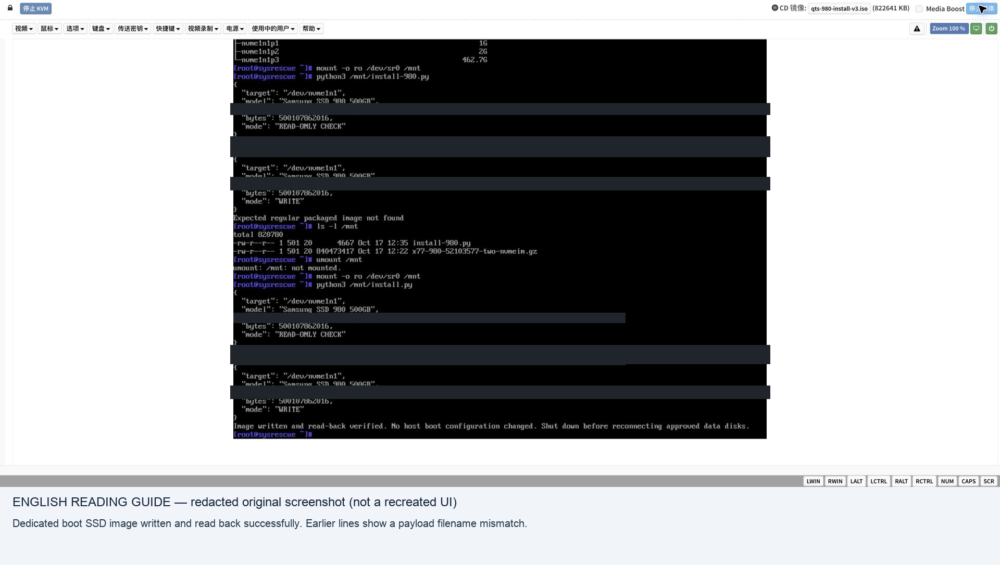

# 4. Build a boot SSD and use virtual CD

<!-- stage-navigation -->
[← Previous: VM validation](03-vm-validation.md) · [Workflow index](../README.md#read-in-this-order) · [Next: Map every bay →](05-bay-mapping.md)
<!-- /stage-navigation -->

For concrete commands and environment prerequisites, use the [ordered command walkthrough](10-command-walkthrough.md). Read this chapter for its acceptance gates and limitations.


This chapter describes the complete build contract and installation sequence. It requires a compatible externally obtained base loader; the repository is not a standalone firmware distribution. Work on regular image files first. Never run image-building commands against original data disks.

## A. Inspect the base image

On an isolated Linux build machine, use `fdisk -l base.img` and `sgdisk -v base.img` to inspect a **regular file**. Record sector size, partition starts/lengths/types/GUIDs and filesystem labels. Mount a disposable copy using a loop device, not a physical NAS disk. An untrusted image belongs in a disposable build VM.

The observed base used 512-byte sectors and these mappings:

| Partition | Start sector | Length (sectors) | Role in this case |
|---|---:|---:|---|
| 1 | 2048 | 32768 | EFI / GRUB |
| 2 | 34816 | 1048576 | Firmware slot |
| 3 | 1083392 | 1048576 | Firmware slot |
| 5 | 2131968 | 16384 | Existing small partition |
| 6 | 2148352 | 16384 | Existing small partition |
| 7 | 2164736 | 5535711 | Support / adaptation files |

The whole DOM view was 16777216 sectors (8 GiB). Preserve the base layout; do not paste this table into a different loader.

## B. Prepare the overlay

Copy [model.conf.example](../templates/model.conf.example) and [init.example](../templates/init.example) into a **private work directory**. Fill in boot identity, exact geometry, all disk-controller paths and ports. The init template deliberately refuses to run with its placeholder values. It is a starting point for the observed NVMe topology, not a multi-namespace NVMe implementation.

The overlay replaces `/sbin/init` with a small wrapper. It mounts proc/sys, selects the boot NVMe by serial and size, validates partitions, creates the bounded DOM views, installs `model.conf` into RAM, and starts BusyBox init. No original QTS binary needs to be edited by the packer. Keep a separate diagnostic entry that runs HAL checks and stops before normal init. Pack a second archive using [diagnostic-init.example](../templates/diagnostic-init.example) as `--init`, and load that archive after the official initrd in the diagnostic GRUB entry. It neither starts normal init nor automatically reboots. Capture the console externally; any module/query error means the diagnostic gate has not passed.

```sh
python3 tools/pack_overlay.py --model private/model.conf --init private/init --output private/profile.cpio.gz
```

The packer reads regular files and writes a new gzip/newc archive. It rejects unresolved template markers and will not overwrite an existing output. Inspect the archive and test it in the VM. A correct archive does not prove a correct hardware profile.

The FLASH boot enclosure points at `/dev/mapper/dom`. Native NVMe HAL paths conflicted with device-mapper ownership in early attempts. The bounded view is **not a write-protection boundary**: the raw disk still exists. Do not offer it as a data disk. The final local wrapper also detached a separately identified other-OS NVMe controller; that machine-specific behavior is not included in the template because one controller may expose multiple namespaces.

## C. Assemble the regular-file image

1. Copy the base image to a new output file. Preserve its GPT and existing EFI loader.
2. Populate both firmware-slot filesystems with the exact selected official payload under `/boot/`, including matching checksum/signature files. In the case, local ext2 partition images were made with `mke2fs -t ext2 -b 1024 -I 128 -m 0 -L QTS_BOOT_PARTN -d STAGING PARTITION_FILE`, with each file pre-sized to the recorded slot length. Run `e2fsck -fn` on each offline partition image.
3. Copy the resulting partition-file bytes into the output image at the recorded offsets, without changing lengths. This step is **only for regular image files**. Match the filesystem features supported by the target kernel.
4. Place `profile.cpio.gz` on the separate support filesystem. Read back and compare its SHA-256. Do not keep the only copy inside a firmware slot.
5. Edit the base's actual GRUB configuration. The observed path on EFI was `/grub/grub.cfg`, not `/efi/grub/grub.cfg`. Load official initrd first and the overlay second; see [grub.cfg.example](../templates/grub.cfg.example). Resolve partitions by verified filesystem UUID/label rather than `(hd0,...)` assumptions.
6. Extract the final output's boot payload again and compare all files with the staged originals. Verify GPT and all changed ranges from the final image, not just intermediate files. Record output byte length and SHA-256.

The original local builder edited an existing FAT16 file chain without growing it. That technique is layout-specific; a normal filesystem-aware edit of a disposable image is preferable to publishing a blind byte patcher. The image's old backup GPT location may reflect its base size. Do not automatically relocate or expand it while testing the updater contract.

## D. Install on the dedicated SSD

**Destructive stage: only the deliberately erasable boot SSD.** Keep data disks disconnected where practical. If another boot disk must remain installed, record an explicit allowlist and verify every serial and capacity again. Never infer the target from NVMe numbering.

Boot SystemRescue through BMC virtual CD with the options in [inventory](01-inventory.md). Confirm it is running from RAM before replacing media. A payload ISO containing files is not itself bootable; the SystemRescue ISO supplies the boot environment. Virtual CD is enough—no USB stick was required in this case.

Before writing, verify:

- Boot target serial, model and exact byte capacity match the private manifest.
- Image length/hash match the verified build and fit the target.
- Target and all its partitions have no mounts, swap, MD/LVM/device-mapper holders or active users.
- No original data member is selected, and the entire device inventory is as expected.
- Existing target contents are intentionally disposable; the image copy will destroy them.

Use a locally reviewed image writer or rescue imaging tool with explicit target selection. The original writer rechecked identity immediately before opening the block device, used exclusive access, wrote the image, flushed it, then hashed a full readback of the image-length range. It also cleared stale GPT bytes at the target tail; that was specific to the disposable target, not a step to apply to data disks. This repository deliberately supplies no auto-selecting disk writer.

After writing, verify the image-length readback hash and partition table. Mount only the boot partitions to confirm EFI, both firmware slots and overlay. Unmount and detach the virtual CD. First boot into the diagnostic entry, then proceed to [bay mapping](05-bay-mapping.md). Do not enable unattended normal boots with original disks until mapping passes.

## Screenshot evidence



See the [full screenshot journal](screenshots.md) for context and translations.

---

<!-- stage-navigation -->
[← Previous: VM validation](03-vm-validation.md) · [Workflow index](../README.md#read-in-this-order) · [Next: Map every bay →](05-bay-mapping.md)
<!-- /stage-navigation -->
