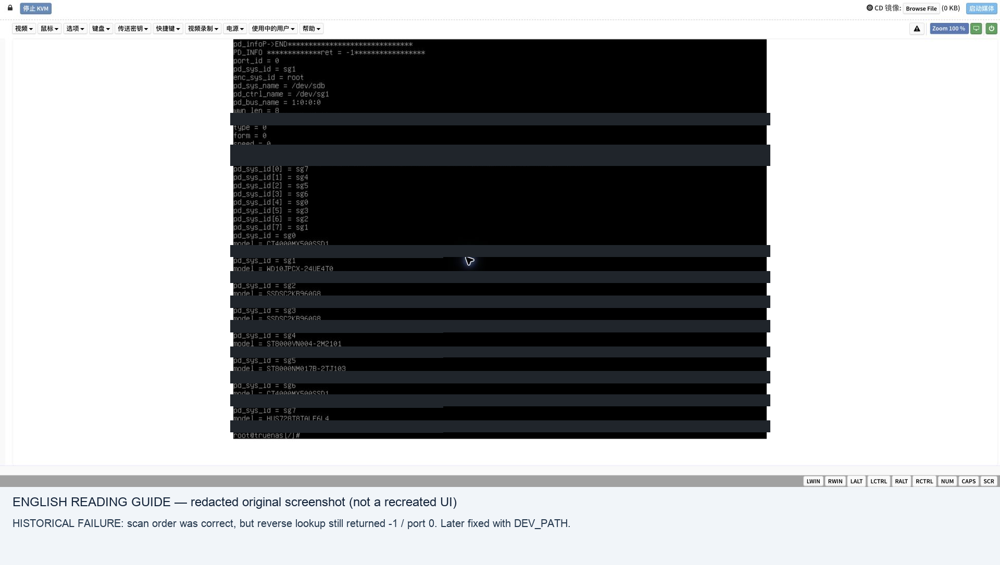

# 5. Map every physical bay

<!-- stage-navigation -->
[← Previous: Build and install](04-build-and-install.md) · [Workflow index](../README.md#read-in-this-order) · [Next: Recover the disk set →](06-migration.md)
<!-- /stage-navigation -->

A working Linux driver and a successful QTS scan are necessary but insufficient. QTS HAL must resolve the same physical disk to the intended enclosure/slot in the reverse query too.

## Collect three views

1. **Physical:** bay label, photo and serial/WWN. Two MX500 SSD labels in this case were partly obscured; visible details helped distinguish them, but the physical 4/5 assignment remained a user-accepted inference rather than an independent LED test.
2. **Linux:** block device, SCSI generic device, controller PCI path and controller-relative port. Read `/sys/class/block/DEVICE/device`, `/sys/class/scsi_generic/sgN/device`, `lsscsi -g`, and `lspci -nnk` in a diagnostic environment. Resolve symlinks with `readlink -f`.
3. **QTS HAL:** actual enumeration and per-disk information under the target firmware's kernel/modules.

In the observed firmware, diagnostic queries were:

```sh
/sbin/hal_app --pd_sys_scan enc_sys_id=root
/sbin/hal_app --pd_sys_getinfo enc_sys_id=root,pd_sys_id=sgN
```

Replace `sgN` with each actual scanned device. The matching `hal_netlink` module was required in the diagnostic environment. Capture complete output rather than reading only the last screenful. Command interfaces may differ by release.

## Concrete Linux topology collection

Run in the intended diagnostic/rescue environment; output contains private serials. These commands enumerate paths without assembling storage:

```sh
lspci -nnk
lsscsi -g
for p in /sys/class/block/sd*; do
  [ -f "$p/partition" ] && continue
  echo "BLOCK ${p##*/}"
  readlink -f "$p/device"
  cat "$p/device/model" 2>/dev/null
  udevadm info --query=property --path="$p" 2>/dev/null | grep -E 'ID_SERIAL=|ID_WWN=|ID_PATH='
done
for p in /sys/class/scsi_generic/sg*; do
  echo "SG ${p##*/}"
  readlink -f "$p/device"
done
for p in /sys/class/net/*; do
  echo "NET ${p##*/}"
  readlink -f "$p/device"
done
```

Match block and sg devices by the resolved SCSI-device path. The enclosing PCI controller path (ending in the controller BDF) is the `DEV_PATH` candidate; do not paste the full `/ata.../host.../target...` leaf as if it were the controller. Record the native path before deciding the controller-relative port. Test candidate ports in diagnostic-only boot with known disk identities; a guessed `ataN - 1` rule is not evidence. Map the NIC's PCI address separately to avoid confusing a disk mapping success with network support.

## Turn the inventory into a tested profile

1. Copy [the bay worksheet](../templates/bay-map.example.csv) into your private records. Enter the physical bay, disk model and full serial/WWN from labels and inventory. Keep uncertain assignments explicitly marked; capacity alone cannot distinguish identical drives.
2. Match each disk's block path to its `sg` path using the resolved sysfs device path. Record the enclosing controller PCI address and its full path. Preserve this evidence outside the NAS.
3. Edit a private copy of the complete physical profile. Change each `[System Disk N]` entry's controller/path/port and slot label according to that evidence. Preserve required platform and network fields; do not replace the whole file with eight disk stanzas. `N` is your intended QTS slot, not an `sgN` suffix.
4. Pack a new diagnostic overlay in a fresh build directory, install it through the reviewed [image assembly process](10-command-walkthrough.md#5-assemble-firmware-slots-support-and-grub), and read it back. During this pre-migration phase, rewriting the dedicated boot SSD requires repeating chapter 4's identity/readback checks. Do not improvise writes to data members. After recovery, preserve the accepted boot image and treat changes as maintenance with a rollback plan.
5. Boot diagnostic, compare the scan against the worksheet, then inspect every per-disk query. If any disk is missing, duplicated, assigned to the wrong slot, or returns an error, correct the profile and repeat. Do not advance because the web installer happens to show disks.
6. For an empty bay, shut down, connect a known disposable disk there, and repeat diagnostic only. Record its identity and result, then remove it while powered off. Do not hot-plug unless that hardware path has separately been validated.

**Exit condition:** every populated bay has an unambiguous identity and successful reverse lookup; empty bays are either tested or explicitly pending. Retain the accepted profile and console log together. Changing cabling, PCI cards or BIOS settings requires rechecking this map.

## The historical failure and its fix

The scan listed all eight disks in the desired order, with correct model and serial, but individual queries returned `ret=-1`, `port_id=0`. The installer later showed missing disks. Therefore the initial scan-only milestone was **not** acceptance.

Testing `PCI_SWITCH_PORT` values 0–31 did not fix it. Inspection of the firmware's HAL reverse lookup showed it interpreted the bridged PCI path differently from forward enumeration. Adding the controller's full `DEV_PATH` alongside `DEV_BUS` and `DEV_PORT` resolved the problem. All eight queries then returned `ret=0` with the intended slots.

```ini
[System Disk 1]
DEV_BUS=B44:D00:F0
DEV_PATH=/sys/devices/pci0000:00/0000:00:01.2/0000:20:00.0/0000:21:0a.0/0000:2c:00.0
DEV_PORT=5
SLOT_NAME=Disk 1
```

This is an **illustration from one motherboard**, not a portable setting. In this profile `B44` corresponds to PCI bus `2c` (decimal vs hexadecimal). `DEV_PORT` was controller-relative; it was not the bay number or the global `ataN` number. BIOS changes, PCI slot changes and cabling can invalidate the map.

## Acceptance table

For every bay, record physical label → serial/WWN → Linux block/sg path → PCI controller/port → HAL slot and return status. Include all bays needed for expansion, not just pool members. For an empty bay, mark it unverified until a known disposable disk has been connected there and checked; do not invent a serial or claim the map has been tested.

Pass requires unique identities, correct ordering and successful reverse lookups for every populated bay. Also verify the boot SSD is excluded from data-disk choices. A mapping affects hardware presentation; it does not itself import the pool or protect an unrelated disk from writes.

Temperature, fan, activity LEDs and hot-swap behavior require their own tests. Setting sensor counts to zero only hides sensors; it does not establish working fan control. Retain independent firmware/BMC thermal management.

## Complete observed profile and final mapping

[Complete case model.conf](../templates/case-x570-model.conf) provides the working configuration structure. It includes the later live-verified CPU, DIMM and cache-port corrections; its CAP/network settings still do not certify those features. The revised overlay has not yet been reboot-tested. The general template remains intentionally incomplete.

This table is transcribed from the final verified mapping record, not the earlier failed-scan screenshot:

| Bay | Disk class | QTS sg device in that boot | Controller / port | Final HAL result |
|---|---|---|---|---|
| 1 | 8 TB HDD | sg7 | 2c / 5 | return 0, slot 1 |
| 2 | 8 TB HDD | sg4 | 2c / 0 | return 0, slot 2 |
| 3 | 8 TB HDD | sg5 | 2c / 1 | return 0, slot 3 |
| 4 | 4 TB SSD | sg6 | 2c / 4 | return 0, slot 4 |
| 5 | 4 TB SSD | sg0 | 2b / 0 | return 0, slot 5 |
| 6 | 960 GB SSD, unrelated | sg3 | 2b / 3 | return 0, slot 6 |
| 7 | 960 GB SSD, unrelated | sg2 | 2b / 2 | return 0, slot 7 |
| 8 | 1 TB HDD, unrelated | sg1 | 2b / 1 | return 0, slot 8 |

The 4/5 physical-label inference noted above still applies. The sg names describe that boot only.

## Screenshot evidence



See the [full screenshot journal](screenshots.md) for context and translations.

## Follow-up: artwork and cache eligibility

Correct HAL mapping did not fix the six-plus-two TS-877 drawing or the zero cache-port bitmap. See [eight-large-bay artwork](07a-hardware-and-apps.md#eight-large-bays-artwork-is-separate-from-disk-mapping) and [slot-based cache eligibility](07a-hardware-and-apps.md#ssd-cache-candidates-a-slot-capability-bitmap) for the separate verified fixes. Neither changes disk identity or authorizes reuse of a disk containing data.

---

<!-- stage-navigation -->
[← Previous: Build and install](04-build-and-install.md) · [Workflow index](../README.md#read-in-this-order) · [Next: Recover the disk set →](06-migration.md)
<!-- /stage-navigation -->
