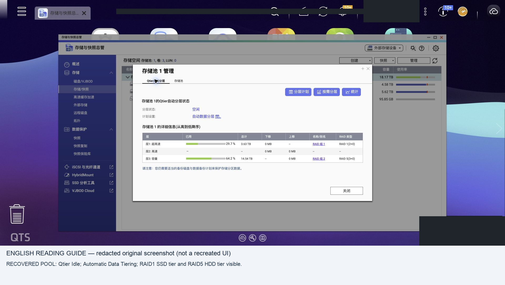

# 6. Recover the original QNAP disk set

<!-- stage-navigation -->
[← Previous: Map every bay](05-bay-mapping.md) · [Workflow index](../README.md#read-in-this-order) · [Next: Independent boot and acceptance →](07-acceptance.md)
<!-- /stage-navigation -->

The storage procedure is shared by both release tracks. The original pool was recovered on 5.2 and later on 6.1; see [the version-specific evidence and limits](11-qts61-upgrade.md#1-what-actually-ran).

## Choose the right branch

QNAP distinguishes an uninitialized destination receiving a complete old system disk set from an already initialized destination attaching another pool. The latter may use **Storage & Snapshots → Disks/VJBOD → Recover → Attach and Recover Storage Pool** (menu grouping varies by version). See [QNAP's migration FAQ](https://www.qnap.com/en-ca/how-to/faq/article/what-should-i-do-if-migrated-disks-are-not-shown-as-storage-pool-qnap-nas).

Those instructions describe supported QNAP appliances; they do not certify a generic PC. In our case, after fixing HAL mapping, normal QTS startup recovered the old configuration and pool automatically. We did **not** click an initialization wizard or run a manual attach/recover action.

## Controlled first storage boot

1. Complete the VM and physical HAL gates. Stop any old recovery VM/service that can access the same disks. Do not allow two systems to manage the same pool.
2. Power down cleanly. Attach the complete identified QNAP set, preserving recorded ordering where possible. Keep unrelated disks out of any storage configuration.
3. Boot the chosen QTS entry deliberately with a console available. Normal QTS startup can assemble arrays and write system metadata automatically. This is the transition out of read-only inventory.
4. Observe startup logs and wait for services. In the case, full management startup took roughly 10–12 minutes. A mounted DataVol1 was progress, not complete acceptance.
5. Find the restored address and management port. Old settings may replace the temporary installer defaults. Log in with the old account; do not reset or initialize to solve an unfamiliar login screen.
6. If a wizard offers initialization, stop. Recheck HAL, firmware family, full disk membership and old system metadata. If an initialized destination offers attach/recover, review exactly which pool and disks are listed before proceeding on copies.

## Verify storage before applications

Compare `/proc/mdstat`, pool status, each RAID group's level/member identities, volume names/types, encryption state and Qtier tier membership with the baseline. Check system arrays as well as data arrays. Do not assume RAID numbers such as md1/md2 are universal.

The recovered case showed two SSDs in RAID1 and three HDDs in RAID5, with no degraded member or rebuild. Qtier showed both tiers and Idle/Automatic Data Tiering. A volume capacity threshold warning was not an array failure.

Read directories, then actual files from every volume. Compare pre-migration hashes where available. Validate shares, users, ACLs, extended attributes, encrypted content and application data separately. Export the important data to an independent destination before experimenting with updates or tuning.

## Cross-architecture application follow-up

Restored storage and app data do not prove every QPKG can run on the destination CPU. The ARM64-to-x86 case retained unregistered app directories. See the [read-only application audit](07a-hardware-and-apps.md#arm64-apps-preserve-data-inventory-before-cleanup) for registration comparison, ELF size accounting and preservation before any reinstall or cleanup.

## What to avoid

Do not recreate a pool with the old disks, treat a missing SSD tier as optional cache, force generic LVM activation, restore stale VG metadata over a live pool, or run repair commands just because a UI is slow. A RAID UUID match alone does not establish a consistent Qtier transaction state.

Our unrelated bays 6–8 were never selected for QTS initialization or pool configuration. An intermediate boot into the old OS occurred and could have auto-mounted its ZFS pool. Thus the record does **not** establish zero writes to those disks. For a new recovery, disconnect unrelated storage where practical and explicitly control which OS boots.

## Screenshot evidence

See the [full screenshot journal](screenshots.md) for context and translations.

---

<!-- stage-navigation -->
[← Previous: Map every bay](05-bay-mapping.md) · [Workflow index](../README.md#read-in-this-order) · [Next: Independent boot and acceptance →](07-acceptance.md)
<!-- /stage-navigation -->
