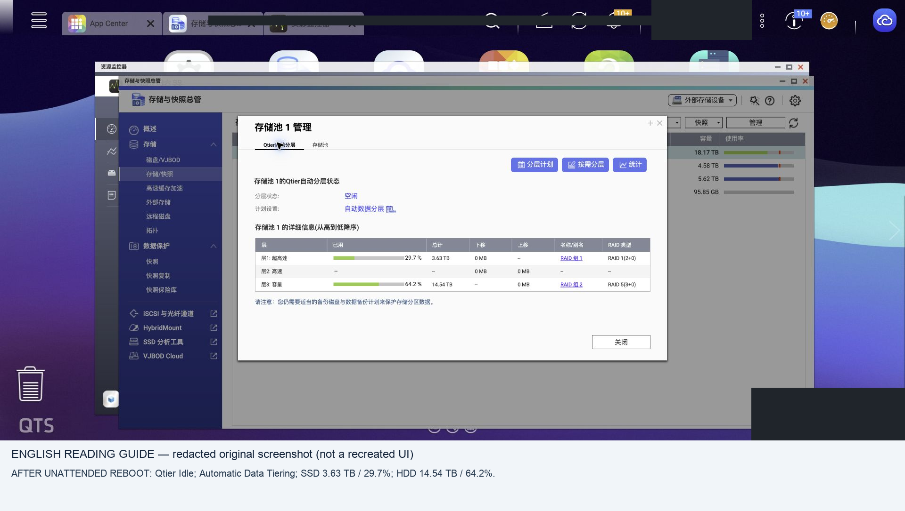

# 7. Independent boot and data acceptance

## Two defaults to set

**GRUB:** back up the actual configuration on the boot SSD. Choose the normal QTS entry by its verified position or stable menu ID, and set a short visible timeout. Our menu had diagnostic first and normal QTS second, so `default=1`, `timeout=3` selected QTS. Do not copy that index to a different menu.

**UEFI:** confirm the QTS boot entry points to the dedicated SSD's EFI partition GUID and `/EFI/BOOT/BOOTX64.EFI` (the observed loader path). Make it first in permanent BootOrder while preserving other entries. `BootNext` only affects one boot and is not proof of a permanent default.

Inspect using `efibootmgr -v` from a maintenance environment booted in UEFI mode. If creating an entry is necessary, identify the disk and EFI partition first; an example pattern is `efibootmgr --create --disk VERIFIED_BOOT_DEVICE --part VERIFIED_ESP_NUMBER --label QTS --loader '\EFI\BOOT\BOOTX64.EFI'`. The placeholders must be replaced after inspection. Set BootOrder using the actual entry numbers and read it back. Do not delete the other OS entry.

QTS in our case lacked efibootmgr and efivarfs support. Mounting efivarfs failed; installing the command alone would not fix missing kernel support. Use the firmware UI or a suitable UEFI-booted maintenance OS. Booting the other installed OS just to change NVRAM can auto-import its storage; prefer maintenance media when protecting unrelated pools.

## Unattended reboot test

Detach virtual CD and verify the BMC reports media inactive. Shut down/reboot normally, with no boot hotkey and no manual GRUB selection. Capture the resulting runtime OS/version, correct boot SSD identity, management access and storage checks. A BMC power confirmation dialog is not proof of reboot completion.

Then perform a full shutdown/start test when safe. Distinguish a normal reboot from a power-off cold boot in your report; our VM had repeated cold boots, while the final physical acceptance record demonstrated an unattended reboot.

## Data acceptance

Use the [acceptance checklist](../templates/acceptance.md). At minimum record:

- Firmware/build and management web/SSH availability.
- Every expected RAID member, no unexpected rebuild, pool and Qtier health.
- Both tier identities and capacities, system volume, every data volume and shares.
- File size/hash comparisons with the source baseline; if absent, label checks as post-recovery readability only.
- Backup/export completion and any remaining warnings.

A GUI saying Ready does not validate every file. A few sample hashes do not validate an entire filesystem. In our case sample full-file reads succeeded, but there was no recorded pre-switch hash baseline for those files.

## Screenshot evidence

See the [full screenshot journal](screenshots.md) for context and translations.
