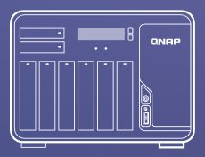
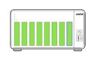

# 7a. Hardware presentation and cross-architecture apps

<!-- stage-navigation -->
[← Previous: Independent boot and acceptance](07-acceptance.md) · [Workflow index](../README.md#read-in-this-order) · [Next: Updates and rollback →](08-updates.md)
<!-- /stage-navigation -->

After storage acceptance, check the hardware pages separately. A recovered pool does not prove correct temperature reporting, DIMM topology, enclosure artwork or SSD-cache eligibility. The observations below apply to **QTS 5.2.10.3577 on the case X570D4U-2L2T / Ryzen 5800X**, using a TS-877 profile.

These fixes were verified in the running system on 2026-10-18 and saved into its boot overlay. **The revised overlay has not yet passed a reboot or cold-start test.** The earlier unattended reboot proves the original storage/boot setup, not these later changes. No cache was created and no application files were deleted.

## CPU, motherboard and fan readings

Two separate problems produced a dashboard with only a zero-valued system-temperature row:

- The TS-877 adaptation did not map the motherboard temperature or fans. The BMC already exposed real readings, but there was no usable native Linux IPMI device or `ipmitool` in this installation.
- The dashboard widget created its CPU row only for the `TS-X82` model family. A working native CPU sensor did not by itself make that row visible under this profile.

Read the native temperature sources before changing sensor counts:

```sh
for h in /sys/class/hwmon/hwmon*; do
    [ -d "$h" ] || continue
    cat "$h/name"
    for f in "$h"/temp*_label "$h"/temp*_input; do
        [ -f "$f" ] && { printf '%s: ' "$f"; cat "$f"; }
    done
done
```

The kernel exposes `k10temp` Tctl and Tccd1. CPU reporting uses QTS's existing `DTS:1` source, not a fabricated BMC replacement. Run `/sbin/get_cpu_temp` with appropriate privileges: an unprivileged zero did not establish a missing sensor. All eight SATA disks already provided their own temperatures; those sources were unchanged.

### Case-specific BMC integration

SMBIOS type 38 identified a KCS interface at I/O address `0xca2`, with successive-byte register spacing. Read-only BMC queries were compared with the BMC sensor page. The accepted mapping on this board was:

| QTS field | Actual source | Example live reading |
|---|---|---|
| CPU temperature | Native `k10temp` / QTS `DTS:1` | 66°C |
| System temperature | BMC motherboard sensor 49 (`0x31`) | 47°C |
| System fan 1 | BMC FAN2, sensor 97 (`0x61`) | 1500 RPM |
| System fan 2 | BMC FAN3, sensor 98 (`0x62`) | 2100 RPM |

These are sampled values, not constants. BMC fan readings use a factor of 100 on this host, matching QTS's IPMI fan interpretation. Sensor numbers, scaling, labels and KCS addresses must be re-established on another board or after relevant firmware changes.

A small local Python adapter implements only the sensor-read subset needed by QTS. Its `ipmitool` entry point accepts `raw 0x04 0x2d` for the four explicitly allowed sensor IDs (49, 52, 97, 98); it is **not a general-purpose ipmitool**. It does not change PWM, fan mode, thresholds or BMC settings. It uses a lock, a bounded transaction timeout and refuses a busy KCS transaction or a newly present native kernel IPMI interface. Direct KCS access is specific to this verified host; do not run an independent kernel/userspace KCS driver concurrently.

The resulting live sensor fields are:

```ini
[System Enclosure]
MAX_TEMP_NUM = 2
CPU_TEMP_UNIT = DTS:1
SYSTEM_TEMP_UNIT = IPMI:49
MAX_FAN_NUM = 2

[System FAN]
FAN_UNIT = IPMI
FAN_1 = I97
FAN_2 = I98
```

Preserve all unrelated model fields and disk mappings. QTS's `[Enclosure_0]` in `/etc/hal.conf` also needs matching `max_temp_num` and `max_fan_num` values. The monitoring daemon caches the model: changing the files or probing HAL alone does not prove that `/tmp/em/em_0.info` or the UI has updated. The current procedure may restart **only the hardware-monitor process**, through its standard `daemon_mgr` invocation, when those sensor settings change. It does not rescan storage or reboot the NAS. During diagnosis an unsupported `hal_daemon --help` invocation unexpectedly restarted the monitor; standard arguments were restored. Do not use daemon help probing as a read-only diagnostic.

The dashboard fix changes the recognized CPU-row condition to require a positive native `cpuTempC` value and removes the model-specific hiding class for that row. It only patches uniquely recognized old/new snippets in `qos-core-widget.js`; an unfamiliar widget is rejected. Refresh the browser cache if it still displays the old widget. No vendor JavaScript or compiled firmware is redistributed here.

### Dashboard before and after

These are actual QTS screenshots from 2026-10-18. The **before** crop comes from the original fault report; the **after** crop was captured from the running system after repair and unified-package deployment. Only the hardware panel is included: accounts, IP addresses, host names, browser tabs, shares and online-user rows are outside the crop. No readings were edited or generated. The original captures use different display scales.

| Before repair | After repair |
|---|---|
|  |  |

**What the Web UI patch changes:** the CPU row is no longer limited to the TS-X82 model family, and its model-specific hiding class is removed. The positive native CPU reading can therefore appear in the dashboard. **What the sensor integration changes:** the System row receives the motherboard reading, and two fan rows receive real BMC RPM values. The after image shows the combined result, not an isolated JavaScript-only experiment. Readings vary with load; the temperature change between captures is not a cooling benchmark. QTS truncates the Fahrenheit suffix in this narrow widget; the Celsius values and RPM remain visible.

This capture proves the running dashboard, not persistence through a reboot or firmware upgrade. The faulty zero-valued row also carried a green indicator, so that icon alone was not evidence of working telemetry.

### Unified one-shot restoration package

The final 2026-10-18 deployment replaces the sensor-only helper with a unified package under `/qts-profile/mods`. Source is in [tools/qts-mods](../tools/qts-mods/reconcile.py); [build_mod_overlay.py](../tools/build_mod_overlay.py) builds an overlay from a reviewed private base, host profile and locally obtained artwork. The package **does not install firmware, reboot the NAS, rebuild privilege rules, create caches or modify disk/pool mappings**.

The boot entry waits at most ten minutes for prerequisites, waits 30 seconds for QTS startup to settle, performs one reconciliation pass and exits. There is no resident process or periodic mod watchdog. Only the already-existing six-hour MyQNAP metadata-refresh job remains scheduled, now pointing to the package's metadata-only helper.

| Module | Compatibility and recovery behavior |
|---|---|
| Sensors | Check host/KCS identity, exclusive access, real BMC/CPU readings and HAL symbols. Run native HAL probes in bounded subprocesses; after changes, compare HAL temperature/fan scaling with BMC and check the monitoring cache. Preserve unfamiliar/native IPMI tools. |
| CPU widget | Independently patch a uniquely recognized CPU-row condition and CSS class. Unknown UI structure is skipped even if sensor collection succeeds. |
| Memory | Match the configured physical bank/locator topology against fresh SMBIOS type-17 records and derive handle offsets. Restore only memory-model fields and stale DIMM cache sections, then verify HAL-populated sizes/offsets. |
| Cache candidates | Require the accepted eight-bay mapping; restore only the known port mask and verify it through HAL. Never select disks or create an SSD cache. |
| Artwork | Accept known vendor/prior asset hashes and expected IDs. The original front has six `hd` IDs plus two `ssd` IDs; the replacement has eight `hd` IDs. Unknown/new artwork is preserved and reported rather than overwritten. |
| MyQNAP index | Validate the local XML route, runtime dependencies and existing repository identity. Restore a missing known registration and replace/deduplicate only the known metadata cron entry, preserving unrelated jobs in both persistent and running crontabs. Fetch/validate a missing index when necessary; never install apps. |

The global gate checks the configured host identity, supported QTS 5.2 family, protected boot/disk/network model sections and PCI paths. It checks firmware identity again before applying each module and rejects a version change during the same boot. The sensor-only package's five exact-binary hashes are no longer the sole compatibility criterion: symbols, bounded native calls and verified readings allow structurally compatible maintenance releases. This is still a **case-specific implementation**, particularly the fixed KCS address/sensor IDs and supported memory/cache layout; editing an example profile does not prove another board compatible.

Each module backs up changed files in a root-only temporary directory, checks for concurrent changes and replaces files atomically. Verification failure rolls back its own changes, retains unrelated/concurrent changes, blocks that module for the rest of the boot and allows other modules to continue. DIMM rollback accounts for HAL's cache-population side effects. Sensor changes may restart only the hardware monitor; no whole-system restart is present.

The builder preserves early boot identity/geometry guards, unrelated-OS exclusion and protected disk/network sections. It removes the old unguarded artwork launch and the old sensor-check launch. Optional memory and cache fields start with neutral defaults; the new modules restore them only after checks. The earlier native CPU source remains configured. A missing loader hook cannot be repaired by a program that never starts.

One summarized QTS System notification uses the **`[QTS Mods]`** prefix and lists each module's restored/OK/skipped outcome. Warnings identify incompatible or failed modules. Identical outcomes are suppressed within a boot. MyQNAP refresh failures preserve the last valid index and report failure/recovery separately. Notification rules and external recipients are not changed.

```text
/tmp/qts-mods/status.json       # Per-module results
/tmp/qts-mods-start.log         # Boot entry output
/tmp/qts-mods/backups/          # Runtime rollback copies; lost at reboot
```

On the adapted host:

```sh
# Preflight: do not apply mod changes or fetch a missing index.
sudo /usr/local/bin/python /qts-profile/mods/reconcile.py --check
# Apply compatible modules once; no firmware installation or reboot.
sudo /usr/local/bin/python /qts-profile/mods/reconcile.py
```

The [example profile](../tools/qts-mods/profile.example.json) is disabled and incomplete. Keep the real profile private: populate exact protected model sections, board identity, PCI paths, known adapter hashes, physical DIMM locators, artwork hashes/IDs and the existing repository/cron definition. Vendor SVGs, firmware images, private identity and ready-to-flash host overlays are not distributed here. Build only after reviewing those inputs:

```sh
python3 tools/build_mod_overlay.py \
  --base private/boot-before.cpio.gz \
  --profile private/profile.json \
  --assets private/artwork \
  --output private/unified.cpio.gz
```

The builder writes a new regular archive and review report; it never mounts or writes a boot device. For the case installation, the separate deployment step verified the dedicated boot SSD identity/geometry and old overlay hash, saved the prior overlay, then wrote and read-back-hashed the new file. Rollback requires the private backup and matching device checks; do not use the other firmware slot as an assumed rollback image.

**Validation:** 28 repository tests passed, including module isolation, unknown-input rejection, idempotence, concurrent-change/symlink protection, cron preservation, subprocess timeout, neutral-memory restoration, DIMM-cache rollback and preservation of early boot guards. QTS Python 2 live preflight passed all six modules. First application updated only the adapter import path and the existing metadata cron entry; a second pass reported all six `ok` with no changes. The metadata helper successfully validated/refreshed 817 application entries without installing packages. The unified overlay was installed and hash-verified with the previous overlay retained.

**Not yet validated:** a reboot/cold start or a real firmware upgrade using this package. The independent startup entry is tested in the running system; this does not establish the full next-boot path. Current arrays remain complete with the prior resync continuing. See the [update design and deployment boundary](08-updates.md#proposed-support-for-routine-updates).

### Monitor recovery correction (2026-10-19)

The first observed restart exposed a recovery bug: the unified package and its hook survived, but `daemon_mgr` returned 1 after a monitor transition. The generic zero-only command wrapper raised before the next start command; the same sequence in rollback left the manager registration at `stop` and no `hal_daemon` process. Sensor files were rolled back and the UI's CPU value was a stale cache. This startup failure does not identify the cause of the preceding orderly shutdown.

The monitor-specific controller now accepts exit 0 or 1 **only after** both the exact manager registration and the actual process list confirm the requested state. Other commands retain strict zero-exit handling; unexpected codes, duplicate/unknown registrations and unconfirmed transitions fail. A failed or timed-out stop attempts a recovery start before reporting the original error. Transaction rollback restores files before recovering the monitor. Command/action, return code and output are retained in diagnostic output.

Startup waits for the native boot marker to clear, the manager and monitor to be running, and prerequisites to exist; it rechecks after a 30-second settling interval. It reopens its output log after native initialization so an early `/tmp` mount cannot hide the log. A bounded timeout still skips restoration. `--only-sensors` scopes an explicitly reviewed live repair without running the other modules. Preserve the failed marker and logs before an authorized retry; do not blindly clear blocked modules.

Validation: **46 tests passed**, including confirmed/non-confirmed exit 1, exit 0 without a state change, unexpected exit codes, stop timeout/start recovery, rollback order, duplicate registration, exact process identity, startup readiness and archive preservation. On the case host, the live sensor-only repair restored the monitor, verified cache timestamps advancing over 20 seconds, and matched HAL motherboard/fan values to BMC readings. A sensor-only preflight then checked the installed mapping. These samples are not an ECO-mode power benchmark.

[patch_monitor_overlay.py](../tools/patch_monitor_overlay.py) updates only `qts-profile/mods/reconcile.py` and `qts-profile/mods/start` in an already unified archive; every other member's content and mode is retained. The case overlay was backed up, installed with boot-device identity/geometry and old/new hash checks, and read-back verified. No NAS reboot, BIOS/fan-policy change, MyQNAP repair or sudo persistence change was performed. **The corrected cold-start path has not yet been validated by a reboot.** Private host overlays, deployment scripts and backup/log data remain outside this public repository.

The following earlier hardware-page capture shows the CPU, DIMMs and disk temperatures; it predates the later motherboard/fan dashboard repair:


## Memory: 0 B in QTS while Linux sees 64 GB

Read `/proc/meminfo` and `dmidecode -t 16 -t 17` with sufficient privileges. The physical setup has four sockets across two channels, with two 32 GiB Micron ECC UDIMMs operating at 3200 MT/s. Linux saw the memory, but the adaptation profile still declared one channel and one slot without a working DIMM source. QTS consequently showed `0 B (63 GB usable)` and an invalid slot/channel label.

The native HAL supports SMBIOS reads using `DIMM_ACCESS = DMI`. The verified configuration was:

```ini
[System Memory]
MAX_CHANNEL_NUM = 2
MAX_SLOT_NUM = 4
DIMM_ACCESS = DMI
SLOT1_ADDR = 1-1, 0x0
SLOT2_ADDR = 1-2, 0x2
SLOT3_ADDR = 2-1, 0x5
SLOT4_ADDR = 2-2, 0x7
```

Here the first pair is the one-based channel/DIMM label. The hexadecimal value is an **offset from the first type-17 SMBIOS handle**, not an I2C address in this DMI mode. This BIOS reported handles `0x17`, `0x19`, `0x1c`, `0x1e`; subtracting `0x17` gives `0`, `2`, `5`, `7`. Re-derive these from your firmware. A BIOS change can invalidate the offsets even if the DIMMs have not moved.

Back up `/etc/platform.conf` before invalidating only stale `[DIMM n]` sections; do not overwrite its platform identity or other sections. Let HAL repopulate the records, then refresh Hardware Information. The verified result was **64 GB (63 GB usable), four slots, empty / 32 GB / empty / 32 GB**, with ECC/UDIMM labels. The QTS decoder still displays manufacturer `Unknown`, although SMBIOS identifies Micron. This verifies reporting, not an ECC fault-injection test.

## Eight large bays: artwork is separate from disk mapping

The TS-877 front image depicts six large bays and two smaller bays. Our eight disks were correctly enumerated as ordinary SATA bays, but two highlights did not match that drawing. Changing the entire model profile merely to obtain another picture could change unrelated hardware behavior.

Instead, we used the **TS-873A front artwork**, which has eight large bays side by side, from the official `TS-X73A_20260731-5.2.10.3577` firmware. This was local resource extraction, not installation of another model's firmware. No vendor SVGs or firmware binaries are redistributed in this repository.

Under `/home/httpd/v3_menu/layout/`, the local replacements were:

| Source artwork | Existing target resource |
|---|---|
| `ts_873a_0.svg` | `ts_877_0.svg` |
| `TS-873A.svg` | `TS-877.svg` |
| `NAS-873A-G.svg` | `NAS-877-G.svg` |

Back up the actual target files and inspect any `model_0.svg` symlink first. Check that the front SVG contains the expected `hd_0` through `hd_7` elements and verify every populated slot's highlight against the already-accepted HAL map. Slots 7 and 8 were explicitly checked here. The device remains a TS-877 profile; only front/static artwork changed, not rear views, SATA mapping or physical chassis identity.

### Chassis artwork before and after

| Original TS-877 artwork | Patched eight-large-bay artwork |
|---|---|
|  |  |

The left crop is from the historical QTS smart-install welcome screen, before recovery; the right crop is from the later Storage & Snapshots disk preview. They show the two actual UI renderings, **not the same page or a new installer run**. The original screenshot was reused without reopening setup. The patch replaces presentation assets only; the accepted SATA/HAL bay mapping remains separate. The wider disk-preview screenshot below supplies the surrounding context. These crops exclude account, network and disk-identity details.


The `Free` label in the disk list means QTS has not allocated those disks; **bays 6–8 still contain unrelated data and are not safe to initialize**.

## SSD-cache candidates: a slot capability bitmap

An empty cache wizard was traced to `SYSTEM_DISK_CACHEABLE_BITMAP = 0x0`, despite QTS identifying SSDs. In this firmware the bitmap describes **eligible enclosure port/slot IDs**, not SSD serial numbers. With verified slots numbered 1–8:

```ini
[System Enclosure]
SYSTEM_DISK_CACHEABLE_BITMAP = 0x1FE
```

`0x1FE` sets bits 1 through 8. The running HAL value is `[Enclosure_0] cache_port_bitmap` in `/etc/hal.conf`; it must agree with the model after refresh. Back up both files before a live change. Do not transplant this mask onto a different numbering scheme or expose the boot SSD as a data/cache candidate.

The wizard then listed disks again: the pool members were In Use, and the Intel SSDs in slots 6 and 7 appeared as candidates. HDD rows may also be listed; that does not make an HDD eligible for SSD caching. The bitmap only removes a port restriction—disk type, health and existing allocation still matter. No disk was selected and the wizard was cancelled. **Cache operation, performance and data safety were not tested.** Qtier's SSD tier remains real pool storage, separate from this feature.


## ARM64 apps: preserve data, inventory before cleanup

The old NAS used ARM64 while the new host is x86-64. An ARM64 executable cannot run natively as an x86-64 QPKG executable. However, architecture alone does not explain every missing App Center entry: registration, enable state, package availability and version compatibility also need checking. Restored pool data does not establish successful app migration. QNAP's [supported migration guidance](https://www.qnap.com/en-us/how-to/faq/article/i-bought-a-new-qnap-nas-how-do-i-move-my-data-over-from-the-old-one) applies to compatible appliances, not this generic host.

A read-only audit should:

1. Keep a private copy of `/etc/config/qpkg.conf`. Compare each registered `Install_Path`, resolved to its real path, with the existing `.qpkg` directories on every relevant volume.
2. Label unmatched directories as **unregistered legacy candidates**, not proven previously enabled apps. Old versions and duplicate directories can exist.
3. Inspect regular files' ELF headers without executing them. Honor the ELF endianness byte; `e_machine` is at bytes 18–19: 183 is AArch64, 40 is ARM, 62 is x86-64. Skip symlinks and deduplicate hard-linked inodes within each app.
4. Report ELF logical bytes separately from whole-directory bytes, compressed archives, data and models. Record permission errors or files disappearing during the scan. Logical sizes are not a promise of reclaimable physical space.
5. Back up app data/configuration before installing a compatible x86-64 package and testing its own restore procedure. Do not simply re-enable the old ARM package or bulk-delete `.qpkg`.

The case scan found **18 unregistered directories totaling about 10.25 GiB**, of which **1.44 GiB** was ARM64 ELF content. Registered Container Station also contained about 972 MiB of ARM64 files in container layers; another registered package bundled a cross-platform ARM64 binary. Those are not automatically obsolete files. Do not delete individual files from container layers. One Container Station read error limited that part of the scan; the remaining app scans had no read errors. All app data and binaries were retained. The full path/file inventory stays private.

## Persist changes and verify them after boot

Editing `/etc/model.conf` or the live web root alone is insufficient on this RAM-root installation. The case's existing custom init copies a model profile out of its initramfs overlay; that source must be updated too. Web assets are extracted later, so the artwork helper waits for the actual target resources before copying the locally extracted replacements. Do not insert a late helper that blocks normal init indefinitely.

Keep the original boot guards, disk paths and unrelated-OS isolation intact. Before replacing an overlay, verify the boot disk's identity, size, partition geometry and device-mapper target; compare the old file's hash, retain a rollback copy, write a temporary file, read it back and rename it into place. Record the new hash privately. A whole-model rescan warning is not a successful acceptance result.

In this case the new overlay was read back successfully and the artwork helper was manually tested. Both data arrays remained complete (`[UU]`, `[UUU]`). The later unified mod overlay was also backed up and hash-verified on the dedicated boot device. **A future authorized reboot still needs to verify the unified one-shot hook, CPU/motherboard/fan readings, DIMM values, all disk temperatures, bay highlights and cache candidate list again.** Recheck these after firmware or BIOS updates too.

Administrative access was verified through SSH and `sudo -n`. Keep credentials out of commands, logs and screenshots. Passwordless administrator access is not required to follow this guide; it was an operator choice in this case, and its reboot persistence was not tested. No sudoers rule or private account details are included here.

---

<!-- stage-navigation -->
[← Previous: Independent boot and acceptance](07-acceptance.md) · [Workflow index](../README.md#read-in-this-order) · [Next: Updates and rollback →](08-updates.md)
<!-- /stage-navigation -->
