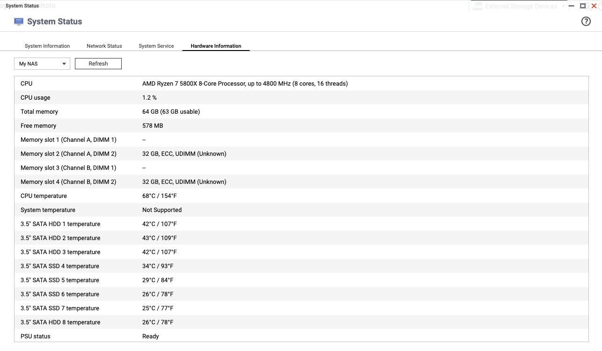
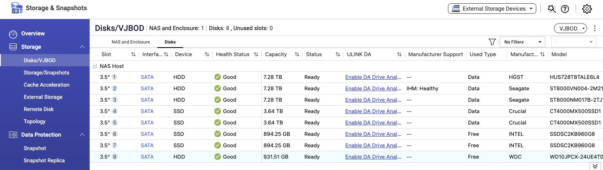
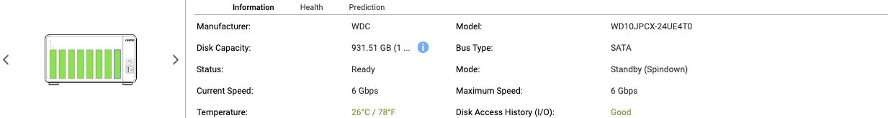
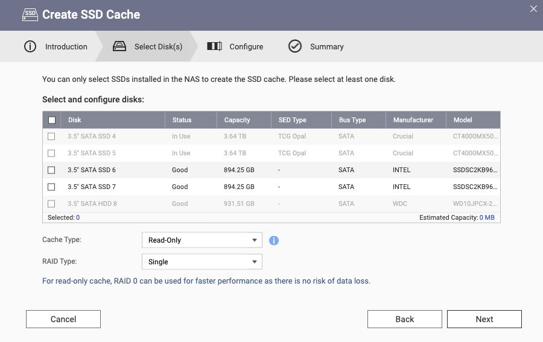

# 7a. Hardware presentation and cross-architecture apps

<!-- stage-navigation -->
[← Previous: Independent boot and acceptance](07-acceptance.md) · [Workflow index](../README.md#read-in-this-order) · [Next: Updates and rollback →](08-updates.md)
<!-- /stage-navigation -->

After storage acceptance, check the hardware pages separately. A recovered pool does not prove correct temperature reporting, DIMM topology, enclosure artwork or SSD-cache eligibility. The observations below apply to **QTS 5.2.10.3577 on the case X570D4U-2L2T / Ryzen 5800X**, using a TS-877 profile.

These fixes were verified in the running system on 2026-10-18 and saved into its boot overlay. **The revised overlay has not yet passed a reboot or cold-start test.** The earlier unattended reboot proves the original storage/boot setup, not these later changes. No cache was created and no application files were deleted.

## CPU and disk temperatures

Read the sources before enabling a sensor count:

```sh
for h in /sys/class/hwmon/hwmon*; do
    [ -d "$h" ] || continue
    cat "$h/name"
    for f in "$h"/temp*_label "$h"/temp*_input; do
        [ -f "$f" ] && { printf '%s: ' "$f"; cat "$f"; }
    done
done
```

The case kernel exposed `k10temp`, including Tctl and Tccd1. The native QTS HAL supported a CPU temperature source through this model configuration:

```ini
[System Enclosure]
MAX_TEMP_NUM = 1
CPU_TEMP_UNIT = DTS:1
```

This is a verified case setting, not a generic sensor-discovery rule. Preserve the other enclosure fields. In the running system the HAL cache also needed its enclosure temperature count refreshed. After backing up the configuration, `/sbin/hal_app --rescan_model` refreshed the model and made the CPU value visible in QTS. That command is a live configuration operation, not a read-only probe; do not run it during an unrelated storage repair. It logged a CPU-info warning in this case, so acceptance relied on the actual `/sbin/get_cpu_temp` result and Hardware Information page, not the command's invocation alone.

All eight SATA disks already supplied temperature information; the hardware page now displays those values alongside CPU temperature. Compare the CPU value to the kernel source and disk values to each disk's health page. A count of one does not expose every k10temp channel as a separate QTS sensor.

**System temperature still reads Not Supported.** This QTS kernel did not expose a usable motherboard sensor/IPMI interface; only k10temp appeared under hwmon. The board's BMC did show motherboard temperatures and fan speeds separately. That does not mean Linux can never read them, or that the sensors are absent. BMC collection and QTS integration were deferred. Keep firmware/BMC fan management in place; do not substitute CPU temperature for motherboard temperature or invent readings.



## Memory: 0 B in QTS while Linux sees 64 GB

Read `/proc/meminfo` and `dmidecode -t 16 -t 17` with sufficient privileges. The physical setup has four sockets across two channels, with two 32 GiB Micron ECC UDIMMs operating at 3200 MT/s. Linux saw the memory, but the adaptation profile still declared one channel and one slot without a working DIMM source. QTS consequently showed `0 B (63 GB usable)` and an invalid slot/channel label.

The native HAL supports SMBIOS reads using `DIMM_ACCESS = DMI`. The verified configuration was:

```ini
[System Memory]
MAX_CHANNEL_NUM = 2
MAX_SLOT_NUM = 4
DIMM_ACCESS = DMI
SLOT1_ADDR = 1-1, 0x0
SLOT2_ADDR = 1-2, 0x2
SLOT3_ADDR = 2-1, 0x5
SLOT4_ADDR = 2-2, 0x7
```

Here the first pair is the one-based channel/DIMM label. The hexadecimal value is an **offset from the first type-17 SMBIOS handle**, not an I2C address in this DMI mode. This BIOS reported handles `0x17`, `0x19`, `0x1c`, `0x1e`; subtracting `0x17` gives `0`, `2`, `5`, `7`. Re-derive these from your firmware. A BIOS change can invalidate the offsets even if the DIMMs have not moved.

Back up `/etc/platform.conf` before invalidating only stale `[DIMM n]` sections; do not overwrite its platform identity or other sections. Let HAL repopulate the records, then refresh Hardware Information. The verified result was **64 GB (63 GB usable), four slots, empty / 32 GB / empty / 32 GB**, with ECC/UDIMM labels. The QTS decoder still displays manufacturer `Unknown`, although SMBIOS identifies Micron. This verifies reporting, not an ECC fault-injection test.

## Eight large bays: artwork is separate from disk mapping

The TS-877 front image depicts six large bays and two smaller bays. Our eight disks were correctly enumerated as ordinary SATA bays, but two highlights did not match that drawing. Changing the entire model profile merely to obtain another picture could change unrelated hardware behavior.

Instead, we used the **TS-873A front artwork**, which has eight large bays side by side, from the official `TS-X73A_20260731-5.2.10.3577` firmware. This was local resource extraction, not installation of another model's firmware. No vendor SVGs or firmware binaries are redistributed in this repository.

Under `/home/httpd/v3_menu/layout/`, the local replacements were:

| Source artwork | Existing target resource |
|---|---|
| `ts_873a_0.svg` | `ts_877_0.svg` |
| `TS-873A.svg` | `TS-877.svg` |
| `NAS-873A-G.svg` | `NAS-877-G.svg` |

Back up the actual target files and inspect any `model_0.svg` symlink first. Check that the front SVG contains the expected `hd_0` through `hd_7` elements and verify every populated slot's highlight against the already-accepted HAL map. Slots 7 and 8 were explicitly checked here. The device remains a TS-877 profile; only front/static artwork changed, not rear views, SATA mapping or physical chassis identity.





The `Free` label in the disk list means QTS has not allocated those disks; **bays 6–8 still contain unrelated data and are not safe to initialize**.

## SSD-cache candidates: a slot capability bitmap

An empty cache wizard was traced to `SYSTEM_DISK_CACHEABLE_BITMAP = 0x0`, despite QTS identifying SSDs. In this firmware the bitmap describes **eligible enclosure port/slot IDs**, not SSD serial numbers. With verified slots numbered 1–8:

```ini
[System Enclosure]
SYSTEM_DISK_CACHEABLE_BITMAP = 0x1FE
```

`0x1FE` sets bits 1 through 8. The running HAL value is `[Enclosure_0] cache_port_bitmap` in `/etc/hal.conf`; it must agree with the model after refresh. Back up both files before a live change. Do not transplant this mask onto a different numbering scheme or expose the boot SSD as a data/cache candidate.

The wizard then listed disks again: the pool members were In Use, and the Intel SSDs in slots 6 and 7 appeared as candidates. HDD rows may also be listed; that does not make an HDD eligible for SSD caching. The bitmap only removes a port restriction—disk type, health and existing allocation still matter. No disk was selected and the wizard was cancelled. **Cache operation, performance and data safety were not tested.** Qtier's SSD tier remains real pool storage, separate from this feature.



## ARM64 apps: preserve data, inventory before cleanup

The old NAS used ARM64 while the new host is x86-64. An ARM64 executable cannot run natively as an x86-64 QPKG executable. However, architecture alone does not explain every missing App Center entry: registration, enable state, package availability and version compatibility also need checking. Restored pool data does not establish successful app migration. QNAP's [supported migration guidance](https://www.qnap.com/en-us/how-to/faq/article/i-bought-a-new-qnap-nas-how-do-i-move-my-data-over-from-the-old-one) applies to compatible appliances, not this generic host.

A read-only audit should:

1. Keep a private copy of `/etc/config/qpkg.conf`. Compare each registered `Install_Path`, resolved to its real path, with the existing `.qpkg` directories on every relevant volume.
2. Label unmatched directories as **unregistered legacy candidates**, not proven previously enabled apps. Old versions and duplicate directories can exist.
3. Inspect regular files' ELF headers without executing them. Honor the ELF endianness byte; `e_machine` is at bytes 18–19: 183 is AArch64, 40 is ARM, 62 is x86-64. Skip symlinks and deduplicate hard-linked inodes within each app.
4. Report ELF logical bytes separately from whole-directory bytes, compressed archives, data and models. Record permission errors or files disappearing during the scan. Logical sizes are not a promise of reclaimable physical space.
5. Back up app data/configuration before installing a compatible x86-64 package and testing its own restore procedure. Do not simply re-enable the old ARM package or bulk-delete `.qpkg`.

The case scan found **18 unregistered directories totaling about 10.25 GiB**, of which **1.44 GiB** was ARM64 ELF content. Registered Container Station also contained about 972 MiB of ARM64 files in container layers; another registered package bundled a cross-platform ARM64 binary. Those are not automatically obsolete files. Do not delete individual files from container layers. One Container Station read error limited that part of the scan; the remaining app scans had no read errors. All app data and binaries were retained. The full path/file inventory stays private.

## Persist changes and verify them after boot

Editing `/etc/model.conf` or the live web root alone is insufficient on this RAM-root installation. The case's existing custom init copies a model profile out of its initramfs overlay; that source must be updated too. Web assets are extracted later, so the artwork helper waits for the actual target resources before copying the locally extracted replacements. Do not insert a late helper that blocks normal init indefinitely.

Keep the original boot guards, disk paths and unrelated-OS isolation intact. Before replacing an overlay, verify the boot disk's identity, size, partition geometry and device-mapper target; compare the old file's hash, retain a rollback copy, write a temporary file, read it back and rename it into place. Record the new hash privately. A whole-model rescan warning is not a successful acceptance result.

In this case the new overlay was read back successfully and the artwork helper was manually tested. Both data arrays remained complete (`[UU]`, `[UUU]`). **A future authorized reboot still needs to verify the CPU/DIMM values, all disk temperatures, bay highlights and cache candidate list again.** Recheck these after firmware or BIOS updates too.

Administrative access was verified through SSH and `sudo -n`. Keep credentials out of commands, logs and screenshots. Passwordless administrator access is not required to follow this guide; it was an operator choice in this case, and its reboot persistence was not tested. No sudoers rule or private account details are included here.

---

<!-- stage-navigation -->
[← Previous: Independent boot and acceptance](07-acceptance.md) · [Workflow index](../README.md#read-in-this-order) · [Next: Updates and rollback →](08-updates.md)
<!-- /stage-navigation -->
