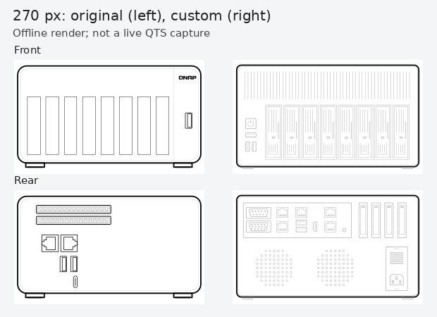
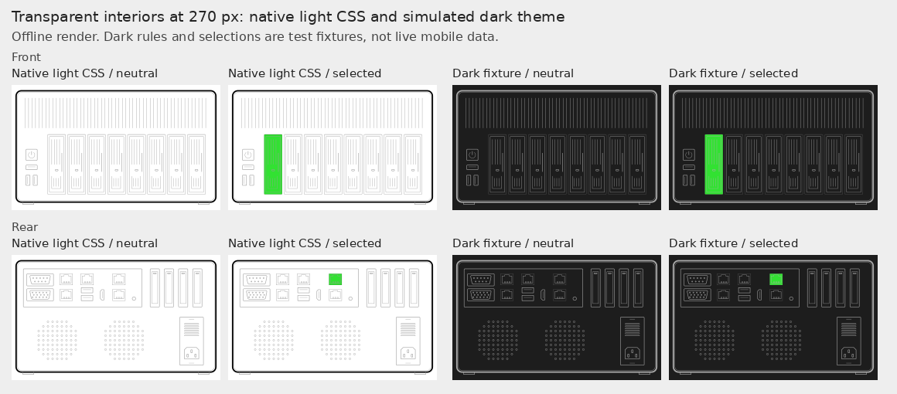

# Custom front/rear chassis display and guarded restoration

This optional, display-only follow-up was completed on 2026-10-24 on the **ASRock Rack X570D4U-2L2T**, QTS **6.1.0 / build 20261007**, kernel **6.6.129-qnap**, TS-873A profile. The ordinary X570D4U is not interchangeable with this board. No NIC numbering, MAC, IP, route, disk enumeration, firmware model, user theme or BMC settings were changed. No NAS reboot or firmware update was performed for this work.

## Result and evidence limits

| Check | Result |
|---|---|
| Current front/rear resources | Installed with original hashes checked, permission-preserving backups and per-file atomic replacement |
| HTTP delivery | Both direct filenames and both `model_0/1.svg` aliases returned HTTP 200 and exactly the approved SVG hashes |
| Front disk protocol | `hd_0`–`hd_7`, direct child `rect`, runtime `qks-slot`, callbacks and tooltips preserved; 98 offline assertions passed using the installed vendor `Slot` class with a minimal element adapter |
| Mobile evidence | An operator screenshot showed the new front drawing and five green slots; the operator subsequently accepted the interior-transparency correction |
| Browser automation | Normal QTS tab creation/read timed out. No claim of comprehensive automated browser hit-testing or all-page acceptance; no security warning or blocked local-file URL was bypassed |
| Restore installation | Official autorun entry and user-startup switch installed; flash contents re-read after remount; temporary mount removed |
| Current-state guard execution | Both `--check` and `--apply` returned `OK_ALREADY_APPLIED`; live SVGs were not rewritten |
| Isolated guard tests | Original recovery, second-run no-op, existing patch, unknown firmware, malformed structure, missing file, changed frontend, mixed files and unknown SVG covered |
| Real reboot / firmware upgrade | **Not tested.** Installing the trigger and simulating recovery do not prove either |

The drawing's logical `hd_N` positions are not independent evidence of physical drive order. The earlier [HAL mapping work](05-bay-mapping.md) is a separate validation milestone. This cosmetic change did not reorder disks or operate on real disk data.

## Artwork and comparisons

The front has power/reset buttons, two vertical USB sockets and eight trays. The rear has a horizontally installed I/O panel at upper left, four chassis expansion openings at upper right, two sparse ventilation-hole arrays and a narrow Flex/1U PSU outline. The board has **three actual PCIe slots**; four chassis covers are not four automatically mapped board slots.



*Offline rendering of original versus custom front/rear resources at equal size. This is not a screenshot of the live QTS page. Original vendor SVG/CSS source is not redistributed.*



*Offline 270-pixel tests: original network CSS on white, simulated theme stroke rules on dark, with neutral and selected examples. The dark rules are a test fixture, not extracted mobile CSS or a live mobile capture. Green selections are test states, not live telemetry. Images contain no host, address, MAC, account or storage identifier.*

Original vector design sources: [front](../assets/chassis/custom-front.svg), [rear](../assets/chassis/custom-rear.svg). These are **design sources**, not a universal drop-in QTS package: the deployed adaptation additionally preserves QTS slot IDs, wrapper groups and native style injection. Do not copy generic physical positions into another host's adapter/disk mapping.

### Figure language and reproducibility

All visible labels in these two figures are English, matching this document. The front/rear hardware SVGs contain no visible text. The figures are regenerated from vector inputs by [render_chassis_comparisons.py](../tools/render_chassis_comparisons.py), rather than editing text over an existing screenshot. Supply locally obtained original SVGs, reviewed adapted SVGs, and the original network CSS; vendor inputs remain private. The renderer requires Pillow and PyGObject/GdkPixbuf with SVG support. It never contacts or modifies a NAS.

```sh
python3 tools/render_chassis_comparisons.py \
  --original-dir /path/to/local-original-layout \
  --adapted-dir /path/to/reviewed-adapted-layout \
  --network-css /path/to/local-style_layout.css \
  --output-dir assets/chassis
```

The dark-theme rule remains an explicit fixture, and selections remain synthetic. Port confidence is unchanged: X550 positions are user-confirmed; i210 positions are inferred.

### Transparent interiors and theme behavior

An initial full-canvas white rectangle looked wrong on the actual mobile disk page. A first correction removed only the surrounding rectangle but left a white chassis body. The accepted final correction removes that body and unnecessary fixed white fills as well. Static strokes no longer use inline hard-coded black colors in the QTS adaptation; native `.shape`, `.others`, `.off` and `.on` rules determine their appearance.

Blank interior pixels were tested transparent, with state fill retained. Native desktop storage CSS can itself fill `.off` white; this application-owned state rule was **not** overridden with `!important`. Therefore “transparent source” does not mean suppressing every color the host UI deliberately assigns. No system theme was changed. Standalone design sources use `currentColor` with a dark-mode fallback; live QTS continues to own its injected CSS.

The original viewBox is 251×143; the design uses 720×430. The outline geometry compensates by 720/251 while retaining `.shape`, so the original network/hardware/storage stroke widths (1.68 / 1.4 / 1.5) remain visually comparable. At equal 270-pixel width the network outline is about 1.81 pixels. Internal lines remain lighter.

## Port mapping and confidence

Read-only QTS network caches, sysfs and controller-driver information established the QTS display name to logical selector relationship. Physical position evidence is recorded separately; MAC ordering was not used to infer a port.

| QTS label | Interface | SVG selector | Rear I/O physical location | Evidence |
|---|---|---|---|---|
| Adapter 1 | `eth0` | `ethernet_0` | i210 lower, LAN1 | **Inferred**, explicitly allowed by operator; not physically measured |
| Adapter 2 | `eth1` | `ethernet_1` | i210 upper, LAN2 | **Inferred**, explicitly allowed by operator; not physically measured |
| Adapter 3 | `eth4` | `ethernet_2` | X550 lower, LAN3 | **User-confirmed** |
| Adapter 4 | `eth5` | `ethernet_3` | X550 upper, LAN4 | **User-confirmed** |

“Adapter 4” is not Linux `eth4`. The board's separate IPMI RJ45 stays a static, independent element: no `ethernet_N` alias or fabricated online highlight. BMC independent status display remains unimplemented; native support is not established by the drawing. USB, VGA, COM, HDMI, buttons and chassis PCIe covers show physical locations only unless a real state source and mapping are separately verified.

See the [official X570D4U-2L2T manual](https://download.asrock.com/Manual/X570D4U-2L2T.pdf), rear I/O diagram (printed page 12), for physical connector definitions.

## Native display contracts

Only these two files were replaced:

```text
/home/httpd/v3_menu/layout/ts_873a_0.svg
/home/httpd/v3_menu/layout/ts_873a_1.svg
```

The existing `model_0.svg` and `model_1.svg` symlinks are preserved. `ts_873a_2.svg` (internal M.2), independent product icons, model lists, JavaScript and CSS are unchanged.

- Network interface details load front/rear objects, remove embedded styles, inject native CSS and select `.off` descendants of the `physical_location` ID. Selection changes `off` to `off on`.
- Storage `ChassisGallery` recognizes `hd_`, `m2_ssd_`, `ssd_` and `u2_ssd_`, creates `qks-slot`, binds click callbacks and colors a slot's **direct child** `rect`. Inline fill/stroke colors must not defeat those rules. Backend slot IDs are not necessarily `hd_N + 1`, especially with M.2/U.2 present.
- Hardware preview loads enabled views and native hardware CSS. PCIe/HDMI state support in the frontend alone does not verify this chassis's physical mapping.
- Other network information/topology callers reference these resources; their existence was inspected, but every page was not interactively exercised.

The 98 tests exercise the actual extracted `Slot` implementation with synthetic backend IDs: click callback output, type/sort order, child tooltips, eight state classes, selection/deselection, disabled/reset, switching, multi-selection and clearing. They do not replace browser pointer-event or real-disk tests. Vendor code and private test captures remain local.

## Installed restoration mechanism

The operator separately approved root startup execution. Existing vendor startup code was inspected before making changes. QNAP's official mount helper exposed the flash configuration at `/tmp/nasconfig_tmp`; no existing `autorun.sh` was present, so the installation recorded that absence rather than overwriting another task. The previous `Misc Autorun` setting was unset.

The installed entry contains a unique `CODEX_NAS_DISPLAY_GUARD_V1` block which launches a fixed-path guard in the background. `Misc Autorun` is now `TRUE`. The root-owned runtime directory holds the guard/engine, two approved payloads, original SVGs, protocol hash manifests, status and reapplication backups. Directory/entry permissions are 0700 and data/helper files 0600. The execution chain and parent directory are checked for root ownership and non-writable-by-other permissions. No sudoers, SSH access, cron job or unrelated shared-directory permission was changed.

The guard:

1. Waits at most 180 seconds for web assets and network frontend resources, without blocking the parent startup process.
2. Checks the expected host, exact firmware version/build, model symlink targets, original/patched SVG hashes and nine JS/CSS/JSON protocol baselines. Fixed SVG hashes bind the reviewed full structure; element checks additionally reject missing slot/network groups. Payload and backup hashes are checked before use.
3. Returns `OK_ALREADY_APPLIED` if both current SVGs match the approved payload. Otherwise it restores only when **both** match the approved originals and all other checks pass.
4. Backs up current resources, preserves owner/mode, stages files in the target filesystem and atomically renames each of the two SVGs. Failed replacement attempts invoke rollback; a mixed or unfamiliar state is stopped for review.
5. Writes a status file. Unknown firmware, frontend changes, missing files, altered structure or unrecognized SVGs produce `STOP_NEEDS_REVIEW`; they are never overwritten just because their IDs look similar.

The existing historical `/qts-profile/mods` artwork implementation was also inspected: its allowed targets are TS-877 filenames, not these TS-873A files. It was not modified.

This is **fail-closed restoration**, not a promise of seamless compatibility with arbitrary future updates. A new firmware version needs fresh source inspection, rendering and operator review before its baseline can be approved. The guard can deliberately leave the vendor artwork in place after an update.

### Status, rollback and removal

Private installation paths and host identifiers are omitted from this public guide. On the installed host, use the reviewed runtime path from its deployment manifest:

```sh
sudo cat <runtime-directory>/STATUS.txt
sudo /bin/sh <runtime-directory>/guard.sh --check
```

These are placeholders, not paste-ready commands. The approved `--apply` is idempotent; do not clear an unexplained lock or failure by repeatedly forcing it. Inspect the reason first. Original and pre-change versions were preserved on the NAS and downloaded to the maintenance workstation, with hashes verified. No private backups are published here.

For display rollback, require the expected current patch hash and matching backup hash, copy the backup with metadata to same-directory temporary files, then atomically replace only the two SVGs and verify HTTP hashes. A rollback that should remain in place must first disable this restoration entry, otherwise the next boot may reapply the approved patch.

For removal, use the official mount helper, back up the **current** autorun content, remove only the marked block, and preserve all other blocks. If the file still exactly equals this installation's newly created file, moving it to the protected backup restores its originally absent state. Disable the user-startup switch only if no other authorized startup process now relies on it. Unmount the temporary flash configuration after verification. Keep recovery copies; do not blindly overwrite later autorun edits with an old backup.

References: [QNAP startup applications](https://www.qnap.com/en/how-to/faq/article/running-your-own-application-at-startup), [checking autorun execution](https://www.qnap.com/en/how-to/faq/article/how-to-confirm-whether-autorun-sh-actually-runs-at-boot). This follow-up did not reboot to test the startup path and did not upgrade firmware to test rejection after a real update.
