# Screenshot journal

Installation, troubleshooting and recovery milestones. Each caption identifies the stage and what the result establishes.

## Native English UI follow-up — 2026-10-18

Hardware and storage status after the follow-up fixes:

- [Hardware status](../assets/screenshots/hardware-status-native-en.jpg): Ryzen 5800X, 64 GB, four memory slots, CPU and eight SATA temperatures. Board temperature remains unsupported.
- [Eight disks](../assets/screenshots/eight-disks-native-en.jpg): all eight disks enumerated. Free does not mean safe to erase; the unrelated disks retain data.
- [Eight-bay front preview](../assets/screenshots/eight-bay-preview-native-en.jpg): eight large bays, with slot 8 selected.
- [Cache candidates](../assets/screenshots/cache-candidates-native-en.jpg): list scrolled to show SSDs 6/7, zero selected; wizard cancelled without creating cache.
- [Qtier](../assets/screenshots/qtier-native-en.jpg): both tiers present, Idle / Automatic data tiering. This is a later live capture, not a new reboot or migration benchmark.

The [follow-up changes](07a-hardware-and-apps.md) were saved to the overlay but have not yet been reboot-tested. The historical journal below keeps its original milestone meanings.

Chinese UI glossary: 存储池 = Storage Pool; 空闲 = Idle; 自动数据分层 = Automatic Data Tiering; 超高速 = Ultra-high-speed tier; 容量 = Capacity tier; 已用 = Used; 总计 = Total; 下移/上移 = Move down/up; RAID 组 = RAID Group.

## 980 Independent Grub

Early boot menu: diagnostic first, normal QTS second. This was not the final default configuration.

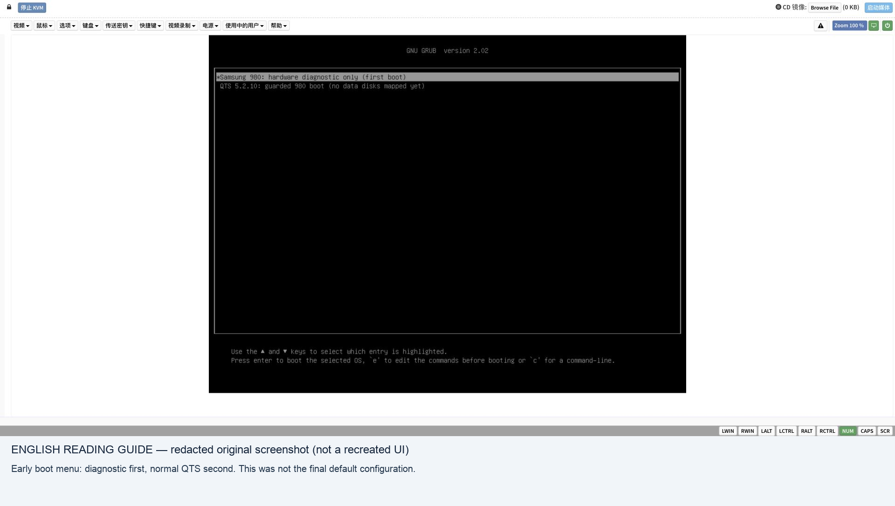

[View screenshot](../assets/screenshots/980-independent-grub.png)

## 980 Write Verified

Dedicated boot SSD image written and read back successfully. Earlier lines show a payload filename mismatch.

[View screenshot](../assets/screenshots/980-write-verified.png)

## Arrays Readonly Complete

Historical inspection: MD RAID1 and RAID5 assembled read-only. This is not proof that later QTS startup is read-only.

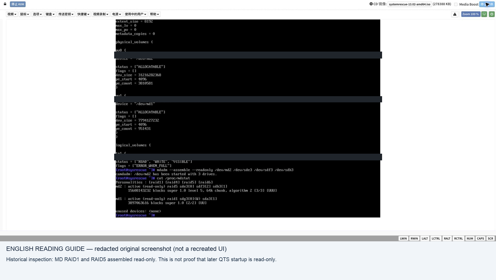

[View screenshot](../assets/screenshots/arrays-readonly-complete.png)

## Bmc Login Required

BMC login required. Re-authenticate and reopen KVM; do not reset the NAS merely to fix a session.

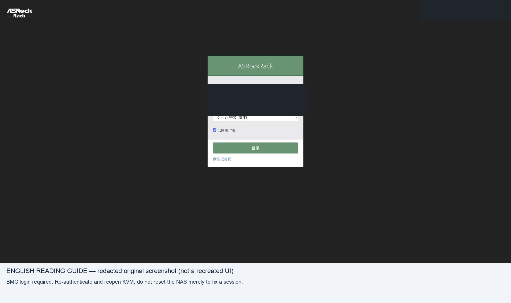

[View screenshot](../assets/screenshots/bmc-login-required.png)

## Bmc Powered Off

BMC power controls. Verify the actual host power state after a shutdown request.

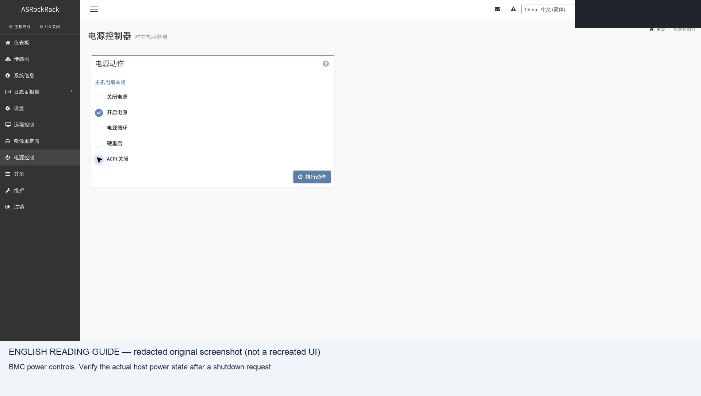

[View screenshot](../assets/screenshots/bmc-powered-off.png)

## Bmc Session Expired

BMC session expired. Console and virtual-media state must be checked after re-login.

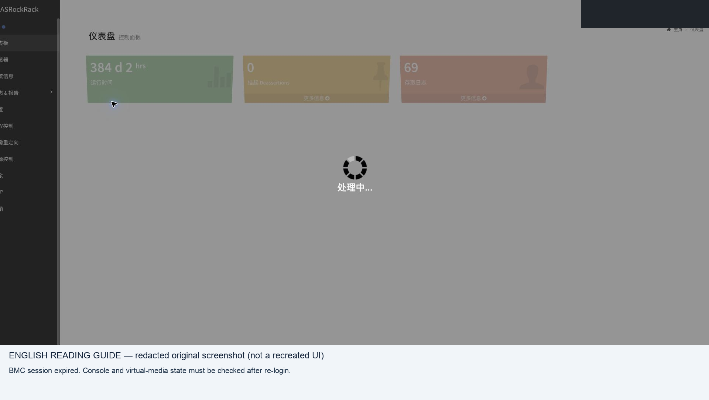

[View screenshot](../assets/screenshots/bmc-session-expired.png)

## Bmc Timeout Limit

BMC web/session timeout settings. Available limits depend on BMC firmware.

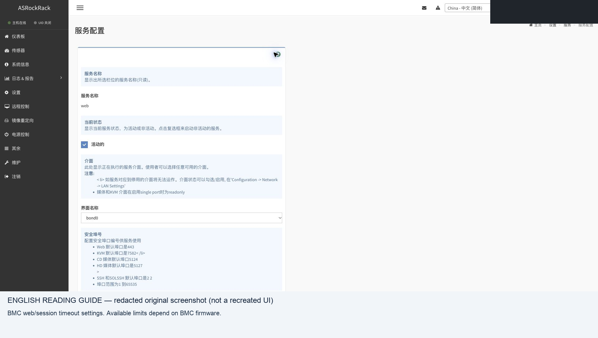

[View screenshot](../assets/screenshots/bmc-timeout-limit.png)

## Eight Bay Hal Verified

HISTORICAL FAILURE: scan order was correct, but reverse lookup still returned -1 / port 0. Later fixed with DEV_PATH.

[View screenshot](../assets/screenshots/eight-bay-hal-verified.png)

## Kvm Partial Access

KVM partial-access/session issue. Console control permissions are separate from QTS health.

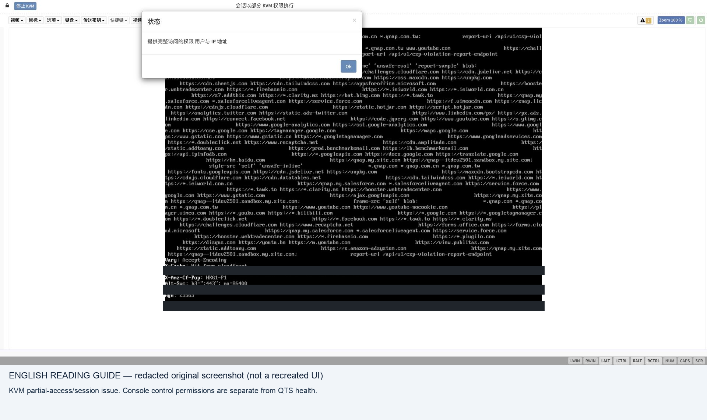

[View screenshot](../assets/screenshots/kvm-partial-access.png)

## Pool Vg1 Hdd Metadata

Historical metadata inspection: HDD-side VG metadata and read-only MD arrays.

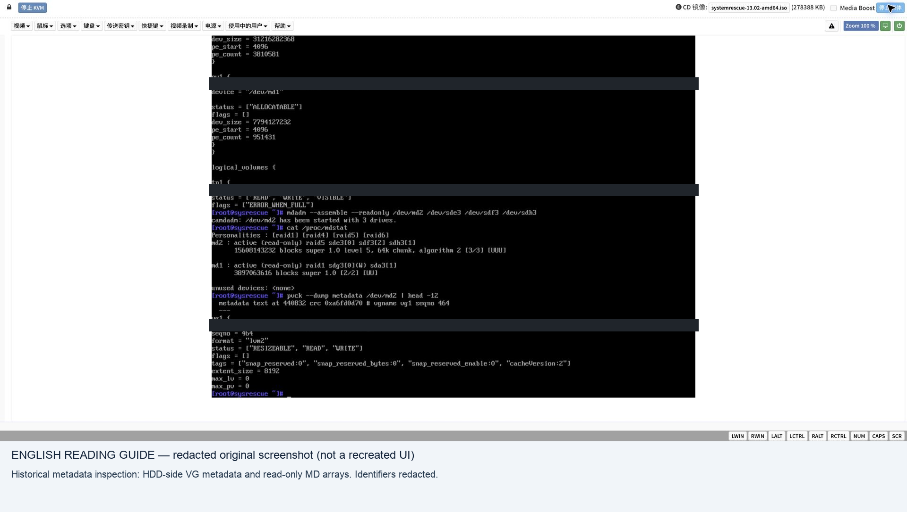

[View screenshot](../assets/screenshots/pool-vg1-hdd-metadata.png)

## Pool Vg1 Metadata

Historical metadata inspection: VG/PV layout. Matching metadata alone does not prove complete data integrity.

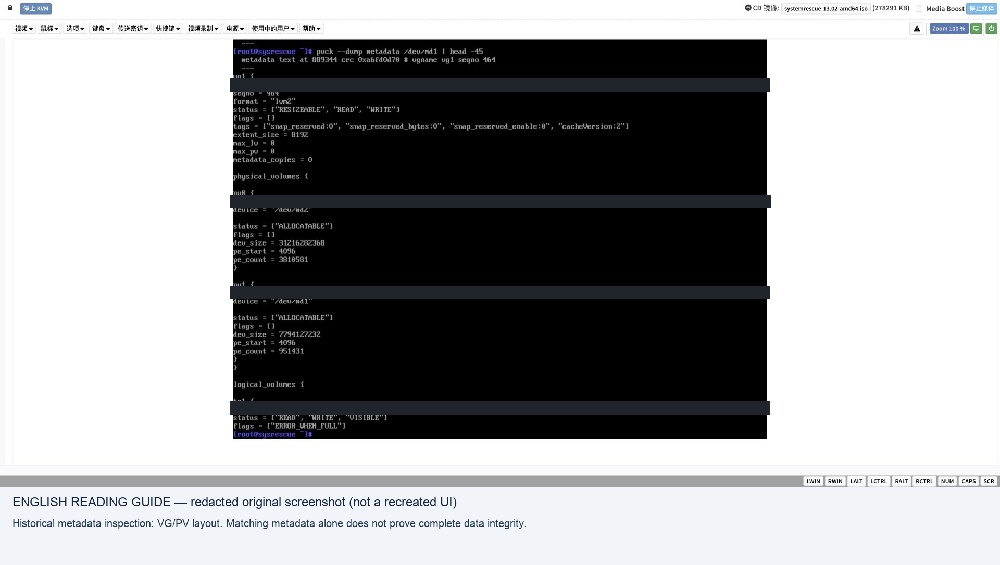

[View screenshot](../assets/screenshots/pool-vg1-metadata.png)

## Qtier After Default Reboot

AFTER UNATTENDED REBOOT: Qtier Idle; Automatic Data Tiering; SSD 3.63 TB / 29.7%; HDD 14.54 TB / 64.2%.

[View screenshot](../assets/screenshots/qtier-after-default-reboot.png)

## Qtier Restored Verified

RECOVERED POOL: Qtier Idle; Automatic Data Tiering; RAID1 SSD tier and RAID5 HDD tier visible.

[View screenshot](../assets/screenshots/qtier-restored-verified.png)

## Qts After Eight Bay Boot

Historical smart-install welcome page before successful recovery. Do not initialize original disks from this page.

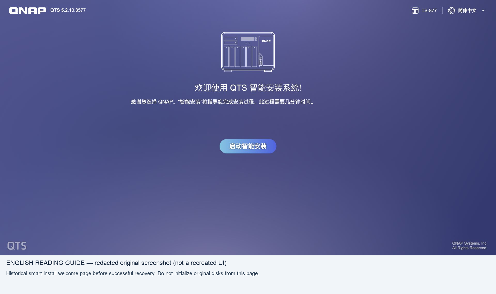

[View screenshot](../assets/screenshots/qts-after-eight-bay-boot.png)

## Qts Baremetal Web

Initial QTS web welcome page with boot SSD. Web availability alone does not validate a recovered pool.

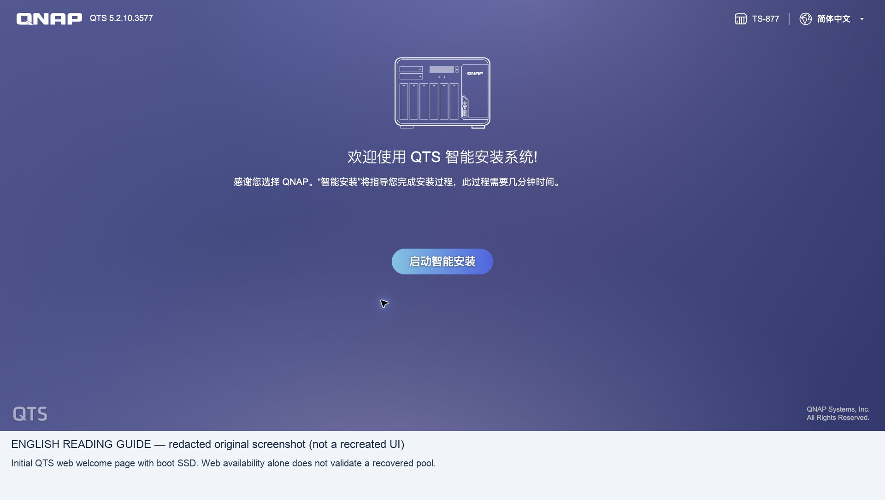

[View screenshot](../assets/screenshots/qts-baremetal-web.png)

## Qts Default Boot Order

Permanent UEFI BootOrder now selects QTS first. Virtual CD shows 0 KB / inactive. Subsequent reboot was verified.

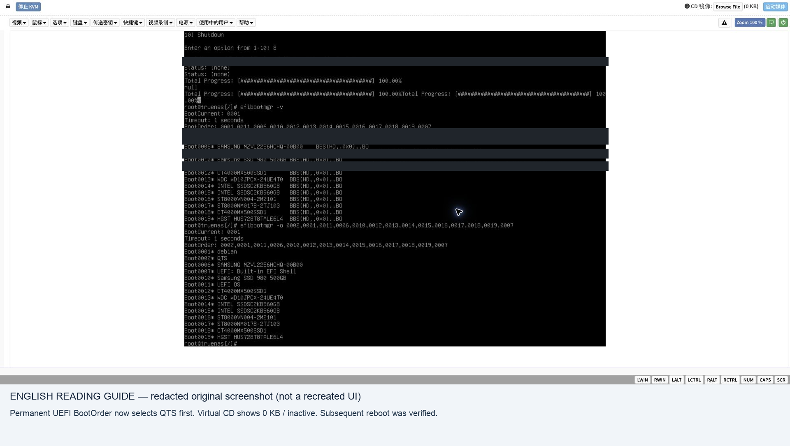

[View screenshot](../assets/screenshots/qts-default-boot-order.png)

## Qts Restored Hostname Login

QTS console login after the old configuration returned.

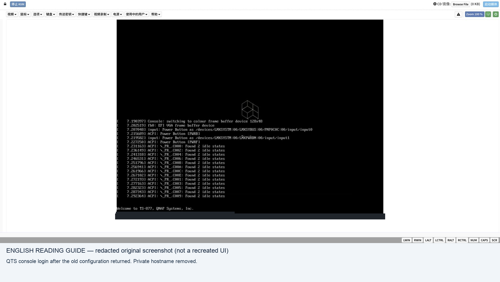

[View screenshot](../assets/screenshots/qts-restored-hostname-login.png)

## Qts Uefi Name

Historical UEFI entry naming and one-time BootNext selection. BootNext is not a permanent default.

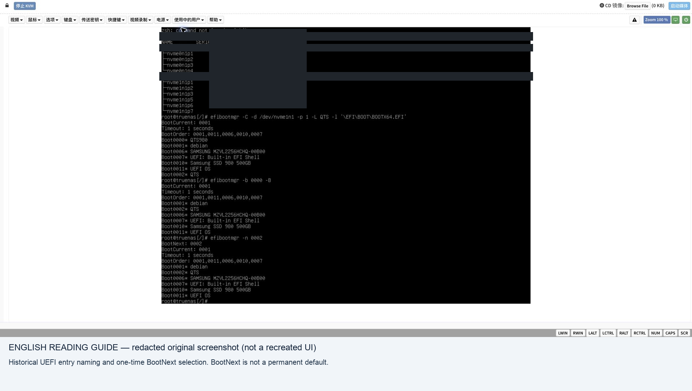

[View screenshot](../assets/screenshots/qts-uefi-name.png)

## Reconnected Disk Inventory

Read-only device inventory after reconnecting disks. Device names can change between boots.

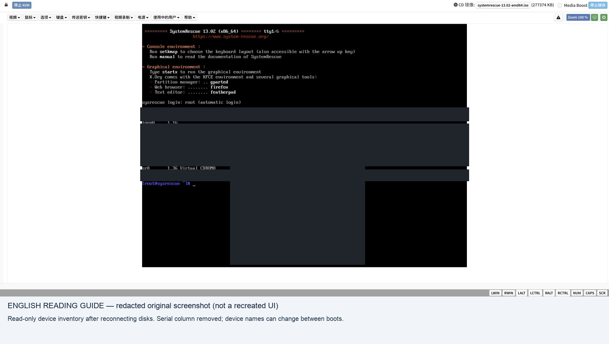

[View screenshot](../assets/screenshots/reconnected-disk-inventory.png)

## Sata Port Mapping

Linux by-path controller/port links. These must be correlated with physical bays and QTS HAL reverse queries.

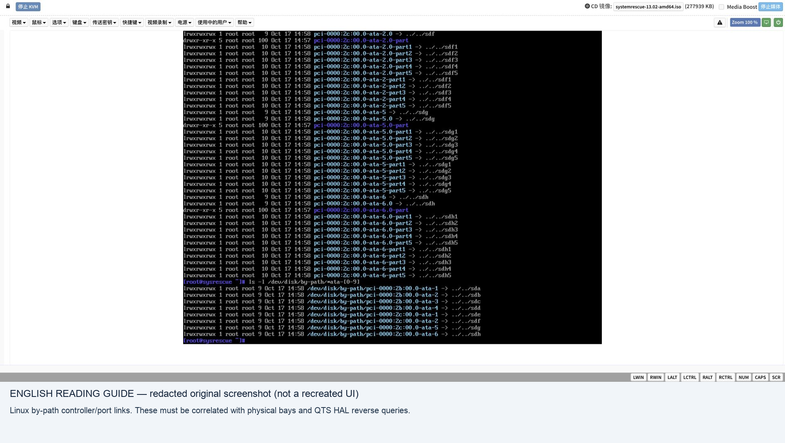

[View screenshot](../assets/screenshots/sata-port-mapping.png)

## Raid Sda3

Historical MD member examination: RAID level, size, role and event counters. Device letters are case-specific.

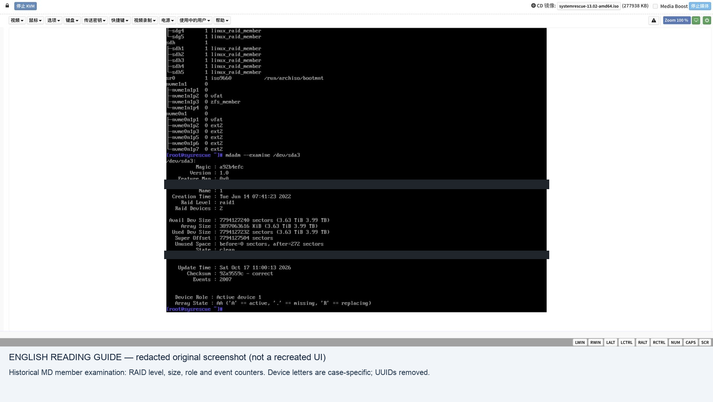

[View screenshot](../assets/screenshots/raid-sda3.png)

## Raid Sde3

Historical MD member examination: RAID level, size, role and event counters. Device letters are case-specific.

[View screenshot](../assets/screenshots/raid-sde3.png)

## Raid Sdf3

Historical MD member examination: RAID level, size, role and event counters. Device letters are case-specific.

[View screenshot](../assets/screenshots/raid-sdf3.png)

## Raid Sdg3

Historical MD member examination: RAID level, size, role and event counters. Device letters are case-specific.

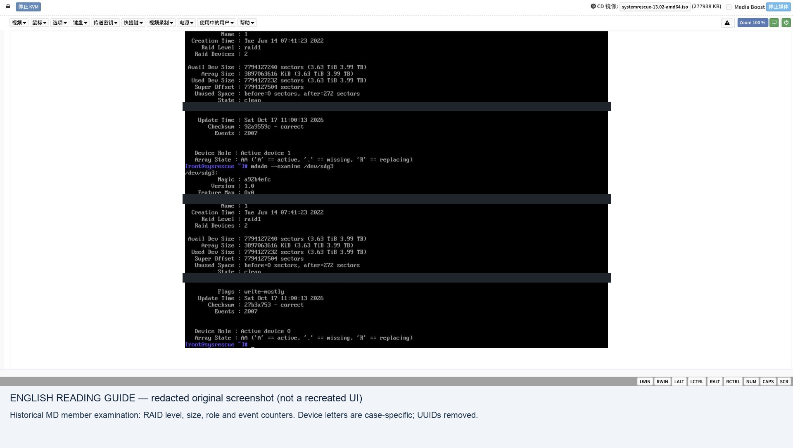

[View screenshot](../assets/screenshots/raid-sdg3.png)

## Raid Sdh3

Historical MD member examination: RAID level, size, role and event counters. Device letters are case-specific.

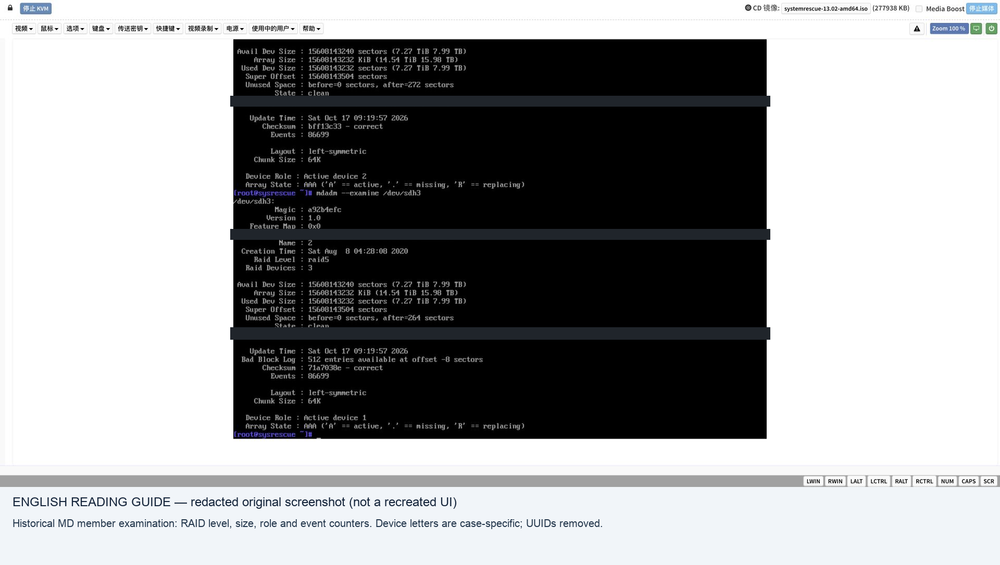

[View screenshot](../assets/screenshots/raid-sdh3.png)
