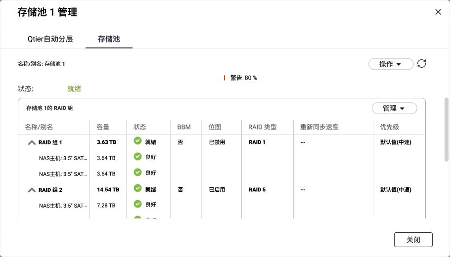
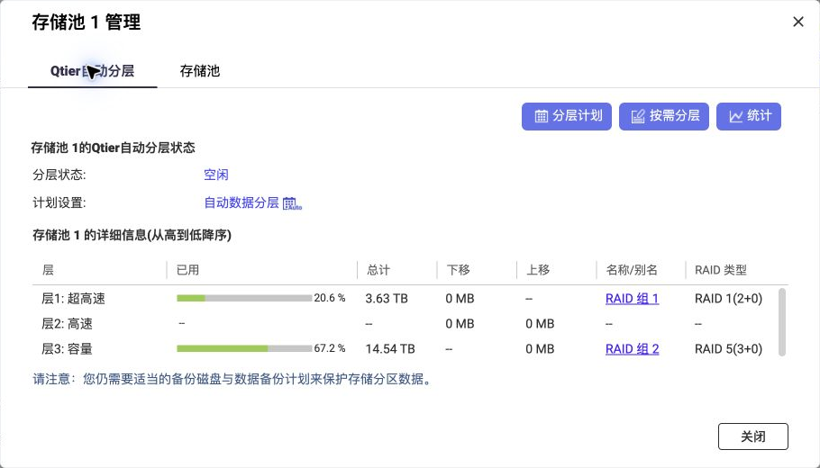
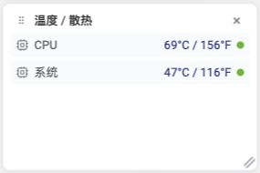
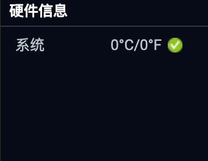
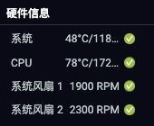
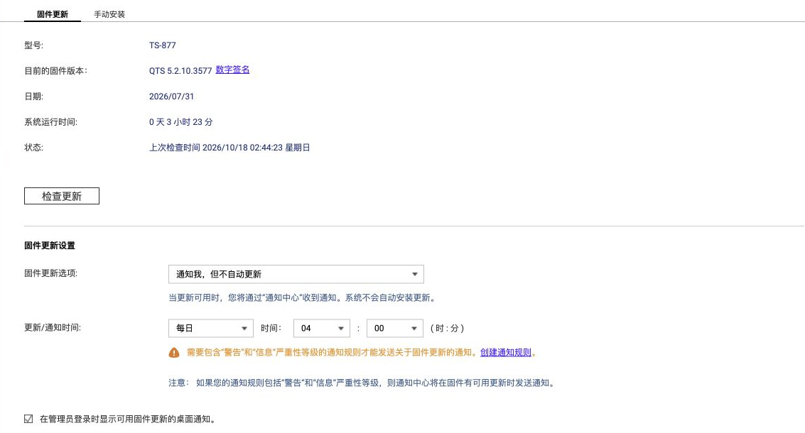

# 中文界面效果图

这些实机截图用于辨认需要检查的状态字段，不代表任意硬件或后续版本均兼容。操作步骤见[英文指南](../README.md)，完整验证范围见[参考结果](case-study.md)。不通过改写截图把旧状态当作新的实测结果。

## QTS 6.1 存储与监控

核对存储池内的 SSD RAID1 与 HDD RAID5，以及每组的实际成员。界面“就绪”不能替代文件读取、校验和独立备份。

两个已用层均存在；中间未使用的层不表示丢盘。按[存储检查步骤](06-migration.md#a-concrete-storage-and-file-checklist)确认容量、状态与原记录一致。

截图样本为 CPU 69°C、系统 47°C。温度随负载变化；用实时传感器和缓存更新时间核对，不能据此判断散热性能或过热关机是否有效。

## 温度与风扇

| QTS 5.2 缺少有效读数 | 传感器与显示适配后 |
|---|---|
|  |  |

两张截图来自不同采样时刻与显示比例。后图同时包含传感器适配和 CPU 行显示修复，不是单独修改界面的效果。绿色图标本身不证明读数有效；验证方法见[硬件指南](07a-hardware-and-apps.md#verify-fresh-readings)。

## 更新通知

核对当前版本界面的选项；不要照抄内部配置数值。通知收件人与发送规则需另行配置，检查更新的时间表也不等于自动安装时间表。参见[更新与回退](08-updates.md#notifications-versus-installation)。
